# DESKRIPSI PERANCANGAN PERANGKAT LUNAK (DPPL)
## SISTEM PEMESANAN TIKET

**Nomor Dokumen:** DPPL-01  
**Revisi:** -  
**Tanggal:** 07/10/2026  

---

### Dipersiapkan untuk:
* Customer (Pengunjung)
* Kasir (PoS Operator)
* Administrator
* Petugas Gate (Gate Staff)

### Disusun Oleh / Kelompok 4:
| No | Nama | NIM |
|:---|:---|:---|
| 1 | Dimas Ramadhani | 103112400065 |
| 2 | Ryan Akeyla Novianto Widodo | 103112400081 |
| 3 | Keishin Naufa Alfaridzhi | 103112400061 |
| 4 | Ariel Ahnaf Kusuma | 103112400050 |
| 5 | Abisar Fathir | 103112400068 |

**PROGRAM STUDI S1 TEKNIK INFORMATIKA**  
**DIREKTORAT KAMPUS PURWOKERTO**  
**UNIVERSITAS TELKOM**  
**2026**

---

## DAFTAR PERUBAHAN

| Revisi | Deskripsi | Tanggal | Pengesah |
|:---|:---|:---|:---|
| A | Draft awal perancangan arsitektur dan use case | 07/10/2026 | Kelompok 4 |
| B | Finalisasi Sequence Diagram, ERD, dan Class Diagram | 07/10/2026 | Kelompok 4 |
| C | - | - | - |
| D | - | - | - |
| E | - | - | - |
| F | - | - | - |
| G | - | - | - |

---

## DAFTAR ISI
1. [BAB I PENDAHULUAN](#bab-i-pendahuluan)
   - [1.1 Tujuan Penulisan Dokumen](#11-tujuan-penulisan-dokumen)
   - [1.2 Lingkup Masalah](#12-lingkup-masalah)
   - [1.3 Definisi dan Istilah](#13-definisi-dan-istilah)
   - [1.4 Referensi](#14-referensi)
2. [BAB II PERANCANGAN](#bab-ii-perancangan)
   - [2.1 Kebutuhan Perangkat Lunak](#21-kebutuhan-perangkat-lunak)
   - [2.2 Realisasi Use Case](#22-realisasi-use-case)
     - [2.2.1 Use Case #1 Menginput Transaksi Tiket (PoS)](#221-use-case-1-menginput-transaksi-tiket-pos)
     - [2.2.2 Use Case #2 Melakukan Pembayaran Kasir & Cetak Struk](#222-use-case-2-melakukan-pembayaran-kasir--cetak-struk)
     - [2.2.3 Use Case #3 Memesan Tiket Online (Self-Service)](#223-use-case-3-memesan-tiket-online-self-service)
     - [2.2.4 Use Case #4 Melakukan Pembayaran Payment Gateway](#224-use-case-4-melakukan-pembayaran-payment-gateway)
     - [2.2.5 Use Case #5 Melakukan Validasi QR Code Tiket](#225-use-case-5-melakukan-validasi-qr-code-tiket)
     - [2.2.6 Use Case #6 Mengubah Status Checked-In](#226-use-case-6-mengubah-status-checked-in)
     - [2.2.7 Use Case #7 Mengelola Master Event & Kuota](#227-use-case-7-mengelola-master-event--kuota)
     - [2.2.8 Use Case #8 Mengelola Katalog Add-on](#228-use-case-8-mengelola-katalog-add-on)
     - [2.2.9 Use Case #9 Mengelola Kode Promo](#229-use-case-9-mengelola-kode-promo)
     - [2.2.10 Use Case #10 Memilih Produk Add-on](#2210-use-case-10-memilih-produk-add-on)
     - [2.2.11 Use Case #11 Menerapkan Kode Promo](#2211-use-case-11-menerapkan-kode-promo)
     - [2.2.12 Use Case #12 Mengakses Laporan Penjualan](#2212-use-case-12-mengakses-laporan-penjualan)
   - [2.3 Perancangan Basis Data (ERD)](#23-perancangan-basis-data-erd)
   - [2.4 Diagram Kelas Keseluruhan](#24-diagram-kelas-keseluruhan)
   - [2.5 Perancangan Detil Kelas](#25-perancangan-detil-kelas)
3. [BAB III MATRIKS KERUNUTAN (REQUIREMENT TRACEABILITY MATRIX)](#bab-iii-matriks-kerunutan-requirement-traceability-matrix)

---

## BAB I PENDAHULUAN

### 1.1 Tujuan Penulisan Dokumen
Dokumen Deskripsi Perancangan Perangkat Lunak (DPPL) ini disusun untuk memberikan spesifikasi arsitektur, perancangan antarmuka pengguna, pemodelan kelas, dan perancangan rinci dari **Sistem Pemesanan Tiket**. Dokumen ini menjadi acuan teknis utama bagi tim pengembang (*developers*), perancang sistem (*system architects*), serta tim penguji (*Quality Assurance*) dalam mengonstruksi perangkat lunak, membangun basis data, mengimplementasikan logika bisnis, dan melaksanakan pengujian sistem.

### 1.2 Lingkup Masalah
Sistem Pemesanan Tiket dirancang untuk mengatasi permasalahan antrean manual, potensi pemalsuan tiket, dan insiden penjualan tiket melebihi kapasitas (*overselling*) pada penyelenggaraan acara pertunjukan dan hiburan. Sistem ini mencakup Point of Sales (PoS) kasir untuk melayani penjualan tiket di lokasi acara (*on-the-spot*), portal Web Storefront mandiri (*self-service*) bagi customer dengan pembayaran digital terintegrasi Payment Gateway, penerbitan e-tiket PDF ber-QR Code unik, serta modul pemindai (*scanner*) gate check-in untuk validasi kehadiran fisik secara cepat. Sistem mengimplementasikan transaksi berbasis prinsip ACID pada basis data relasional MySQL guna menjamin konsistensi data kuota tiket pada kondisi transaksi bersamaan (*high concurrency*).

* **Product Champion**: Administrator / Penyelenggara Acara.
* **User Class / Role**:
  * **Administrator**: Mengelola konfigurasi sistem, jadwal acara, master tier tiket, kuota, katalog add-on, voucher promo, dan mengakses laporan penjualan.
  * **Kasir (PoS Operator)**: Mengoperasikan terminal kasir PoS di lokasi untuk melayani transaksi langsung dan mencetak struk fisik.
  * **Pengunjung / Customer**: Melakukan registrasi, pemesanan tiket mandiri secara daring melalui portal web atau on-the-spot, serta menggunakan tiket untuk akses gerbang masuk acara.
  * **Petugas Gate (Gate Staff)**: Memindai dan memvalidasi keabsahan QR Code e-tiket pengunjung di gerbang masuk acara.

### 1.3 Definisi dan Istilah

#### Tabel 1: Definisi dan Istilah
| Istilah | Definisi |
|:---|:---|
| **DPPL** | Deskripsi Perancangan Perangkat Lunak. |
| **SKPL** | Spesifikasi Kebutuhan Perangkat Lunak. |
| **PoS** | Point of Sales (Aplikasi kasir transaksi langsung di tempat). |
| **QRIS** | Quick Response Code Indonesian Standard. |
| **ACID** | Atomicity, Consistency, Isolation, Durability (Prinsip transaksi basis data relasional untuk menjaga integritas data). |
| **MVC** | Model-View-Controller (Pola arsitektur perancangan perangkat lunak). |
| **BCE** | Boundary-Controller-Entity (Pola pemodelan objek antarmuka, kontrol bisnis, dan entitas data). |
| **Tier** | Kategori tiket yang memiliki variasi harga dan kuota tersendiri (misal: Batch 1, Batch 2, VIP). |
| **Add-on** | Produk pelengkap di luar tiket utama seperti makanan ringan atau cinderamata (*merchandise*). |

### 1.4 Referensi
* Dokumen Spesifikasi Kebutuhan Perangkat Lunak (SKPL) Sistem Pemesanan Tiket, Kelompok 4, Program Studi S1 Teknik Informatika, Universitas Telkom Purwokerto, 2026.
* Panduan Tugas #1: Perencanaan Konstruksi Perangkat Lunak, Telkom University.
* IEEE Std 1016-2009: IEEE Standard for Information Technology—Systems Design—Software Design Descriptions.

---

## BAB II PERANCANGAN

### 2.1 Kebutuhan Perangkat Lunak

#### Tabel 2: Kebutuhan Perangkat Lunak
| Kode FR | Nama / Deskripsi Kebutuhan Fungsional | Tipe FR |
|:---|:---|:---|
| **KF-01** | Sistem harus memungkinkan kasir untuk memasukkan atau memindai kode barang/tiket dan secara otomatis menampilkan harga satuan. | Must Have |
| **KF-02** | Sistem harus mengkalkulasi subtotal dan total akhir secara real-time saat kuantitas item ditambahkan atau dikurangi. | Must Have |
| **KF-03** | Sistem harus memvalidasi ketersediaan kuota tiket sebelum memproses transaksi. | Must Have |
| **KF-04** | Sistem harus memvalidasi dan memotong harga jika kode promo yang dimasukkan valid (sesuai tanggal, minimum transaksi, dan kuota promo). | Satisfy |
| **KF-05** | Sistem harus memvalidasi nominal uang tunai yang dimasukkan dan menampilkan informasi uang kembalian. | Must Have |
| **KF-06** | Sistem harus dapat mencetak struk belanja (kertas termal atau PDF) yang memuat QR Code unik untuk validasi masuk. | Must Have |
| **KF-07** | Sistem harus memungkinkan administrator menambah, mengubah, dan menghapus master data tiket, add-on, dan promo. | Must Have |
| **KF-08** | Sistem harus memungkinkan sistem gate check-in untuk memindai QR Code dan menandai status tiket menjadi 'Checked-In'. | Must Have |
| **KF-09** | Sistem harus memiliki portal publik yang memungkinkan pengunjung melakukan registrasi dan login akun secara mandiri. | Satisfy |
| **KF-10** | Sistem harus memungkinkan pengunjung untuk memasukkan tiket dan add-on ke keranjang belanja (cart) dan melakukan checkout mandiri secara online. | Must Have |
| **KF-11** | Sistem harus terintegrasi dengan Payment Gateway pihak ketiga untuk memproses pembayaran pengunjung secara online (Virtual Account, E-Wallet, QRIS). | Must Have |
| **KF-12** | Sistem harus secara otomatis mengirimkan e-tiket ber-QR code ke email pengunjung setelah pembayaran online divalidasi berhasil. | Delighter |

---

### 2.2 Realisasi Use Case

Berikut adalah **Use Case Diagram** untuk Sistem Pemesanan Tiket:

#### Gambar 1: Use Case Diagram Sistem Pemesanan Tiket
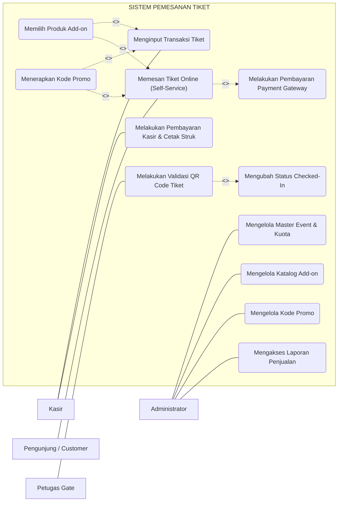

#### Tabel 3: Pendeskripsian Use Case
| No | Nama Use Case | Deskripsi Use Case |
|:---|:---|:---|
| **#1** | Menginput Transaksi Tiket (PoS) | Kasir memasukkan pesanan tiket pengunjung langsung di lokasi ke keranjang belanja PoS. |
| **#2** | Melakukan Pembayaran Kasir & Cetak Struk | Kasir menginput nominal pembayaran tunai/non-tunai dan mencetak struk fisik atau PDF ber-QR Code. |
| **#3** | Memesan Tiket Online (Self-Service) | Pengunjung memilih tiket dan kuantitas tiket secara mandiri via web portal storefront. |
| **#4** | Melakukan Pembayaran Payment Gateway | Pengunjung menyelesaikan transaksi online secara otomatis melalui gateway pembayaran (*&lt;&lt;include&gt;&gt;* dari Memesan Tiket Online). |
| **#5** | Melakukan Validasi QR Code Tiket | Petugas gate memindai QR Code pada struk/e-tiket pengunjung saat memasuki arena acara. |
| **#6** | Mengubah Status Checked-In | Sistem memvalidasi keaslian tiket dan memperbarui statusnya menjadi 'Checked-In' secara otomatis (*&lt;&lt;include&gt;&gt;* dari Validasi QR Code). |
| **#7** | Mengelola Master Event & Kuota | Admin mengatur jadwal acara, kategori tier tiket (Batch 1, Batch 2, VIP), harga, dan batas kuota. |
| **#8** | Mengelola Katalog Add-on | Admin mengelola katalog produk pelengkap (snack/merchandise), harga satuan, dan ketersediaan stok. |
| **#9** | Mengelola Kode Promo | Admin membuat voucher diskon, mengatur batas masa aktif, ketentuan minimal transaksi, dan kuota pemakaian. |
| **#10** | Memilih Produk Add-on | Opsi tambahan (*&lt;&lt;extend&gt;&gt;*) bagi pembeli tiket untuk menambahkan snack/merchandise ke dalam keranjang transaksi. |
| **#11** | Menerapkan Kode Promo | Opsi tambahan (*&lt;&lt;extend&gt;&gt;*) bagi pembeli untuk mengklaim kode kupon diskon guna memotong total tagihan jika syarat terpenuhi. |
| **#12** | Mengakses Laporan Penjualan | Admin memantau rekapitulasi data penjualan harian, statistik per tier, dan ekspor laporan transaksi. |

---

### 2.2.1 Use Case #1 Menginput Transaksi Tiket (PoS)

#### Use Case Scenario #1
* **Pre-Condition**: Kasir telah berhasil melakukan login dan membuka antarmuka PoS terminal.
* **Use Case Description**: Kasir memilih kategori tiket dan memasukkan kuantitas pesanan pengunjung on-the-spot ke dalam keranjang belanja PoS.
* **Primary Flow**: Kasir memilih jenis tiket dari daftar, menginput kuantitas, sistem memvalidasi ketersediaan kuota, lalu item ditambahkan ke keranjang belanja PoS.
* **Alternative Flow**: Jika kuota tiket habis, sistem menampilkan peringatan stok habis dan membatalkan penambahan item ke keranjang.
* **Post-Condition**: Tiket berhasil masuk ke dalam keranjang belanja PoS dengan kalkulasi subtotal otomatis.

#### Gambar 2: Activity Diagram Menginput Transaksi Tiket (PoS)
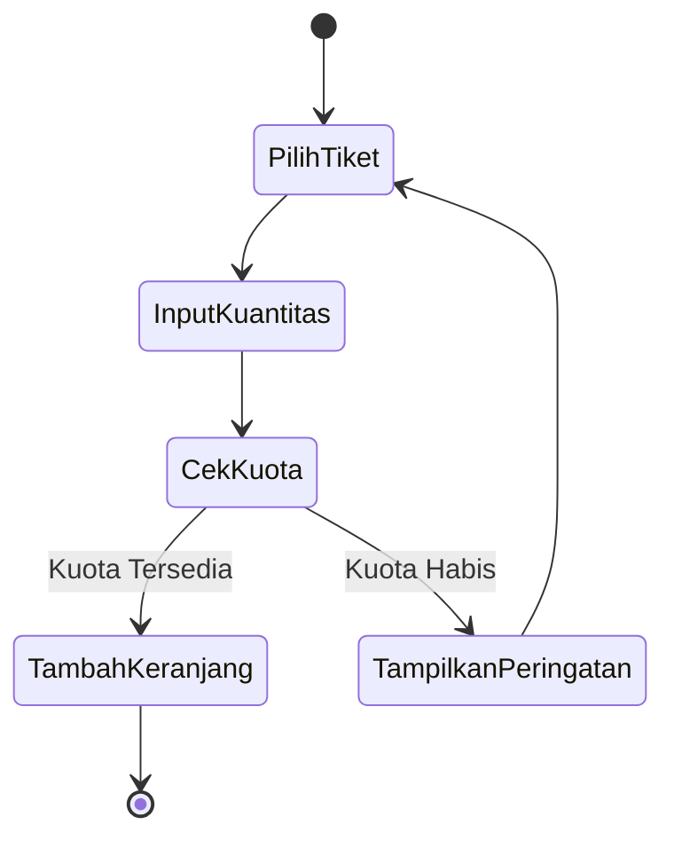

#### UI Design dan Deskripsi Objek UI #1
Antarmuka Terminal PoS Kasir untuk pemilihan tiket dan kuantitas transaksi langsung di lokasi acara.

#### Gambar 3: UI Halaman Transaksi Kasir PoS (PoS-01)
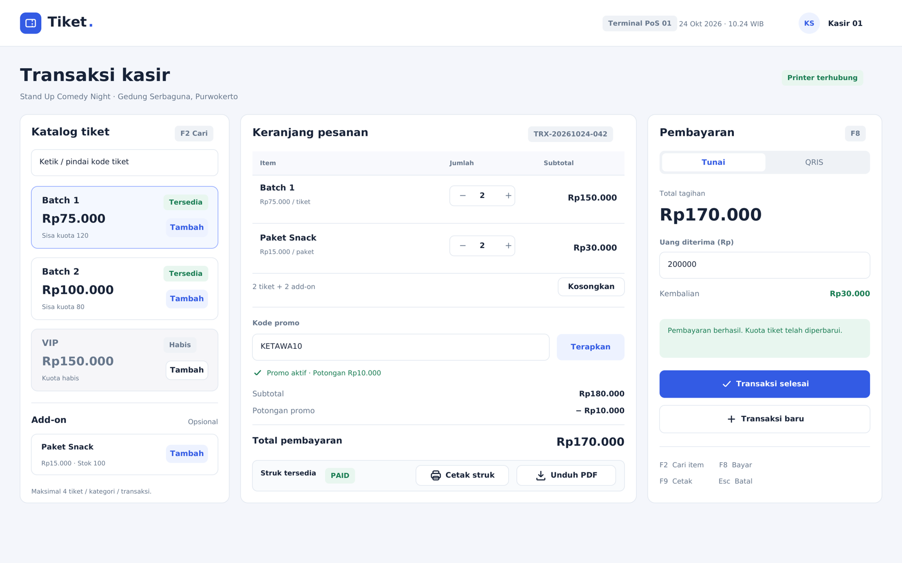  
*(Lokasi File UI Alternatif: `doc_tugas1/UI/1791434437699-5b2aadb6-c872-4e20-a07d-0862ff0852cd_1.jpg`)*

#### Tabel 4: Tabel Deskripsi Objek UI Transaksi Kasir PoS (PoS-01)
| ID LAYAR | NAMA LAYAR | DESKRIPSI |
|:---|:---|:---|
| **POS-01** | Halaman Transaksi Kasir PoS | Antarmuka kasir untuk memilih tiket, menginput kuantitas, dan mengelola keranjang transaksi. |

#### Tabel 5: Spesifikasi Detail Antarmuka POS-01: Halaman Transaksi Kasir PoS
| Id_Objek | JENIS | LABEL | Keterangan |
|:---|:---|:---|:---|
| `cmbTiket` | Dropdown | Pilih Kategori Tiket | Memilih jenis/tier tiket yang dibeli pengunjung. |
| `txtKuantitas` | Textbox | Kuantitas | Menginput jumlah tiket yang dipesan. |
| `btnTambah` | Button | Tambah ke Keranjang | Menambahkan item tiket ke daftar keranjang belanja. |
| `tblKeranjang` | Table | Daftar Pesanan | Menampilkan rincian item, kuantitas, harga, dan subtotal. |

#### Identifikasi Object dan Tipe Kelas #1
Identifikasi objek yang terkait dengan Use Case #1 Menginput Transaksi Tiket (PoS):

#### Tabel 6: Object Perancangan Use Case #1
| No | Nama Object Baru | Jenis / Tipe Kelas |
|:---|:---|:---|
| 1 | `PoSView` | Boundary (Interface) |
| 2 | `TransactionController` | Controller (Pemrosesan) |
| 3 | `TicketEntity` | Entity (Basisdata) |

#### Gambar 4: Sequence Diagram Menginput Transaksi Tiket (PoS)
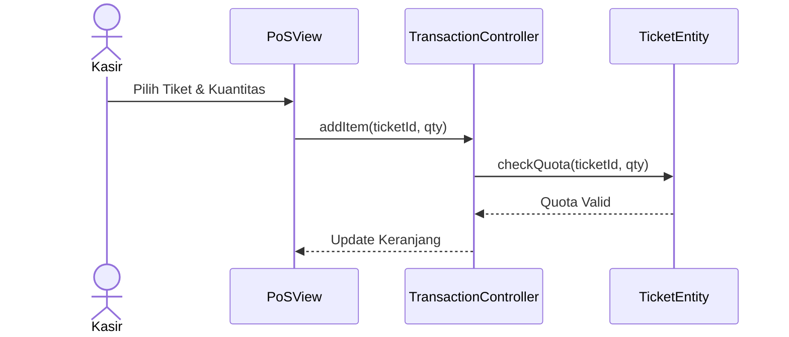

---

### 2.2.2 Use Case #2 Melakukan Pembayaran Kasir & Cetak Struk

#### Use Case Scenario #2
* **Pre-Condition**: Keranjang belanja PoS telah terisi item tiket dan total tagihan telah terkalkulasi.
* **Use Case Description**: Kasir menerima uang pembayaran dari pengunjung, menginput nominal cash/non-cash, memproses kembalian, menyimpan transaksi, serta mencetak struk cetak/PDF ber-QR Code.
* **Primary Flow**: Kasir memasukkan nominal pembayaran tunai, sistem menghitung kembalian, mengonfirmasi transaksi sukses, memperbarui kuota/stok, dan mencetak struk fisik thermal ber-QR Code.
* **Alternative Flow**: Nominal pembayaran kurang dari total tagihan, sistem menampilkan peringatan dan meminta kasir memasukkan nominal yang mencukupi.
* **Post-Condition**: Transaksi tercatat di basis data dan struk berisi QR Code tiket berhasil dicetak.

#### Gambar 5: Activity Diagram Melakukan Pembayaran Kasir & Cetak Struk
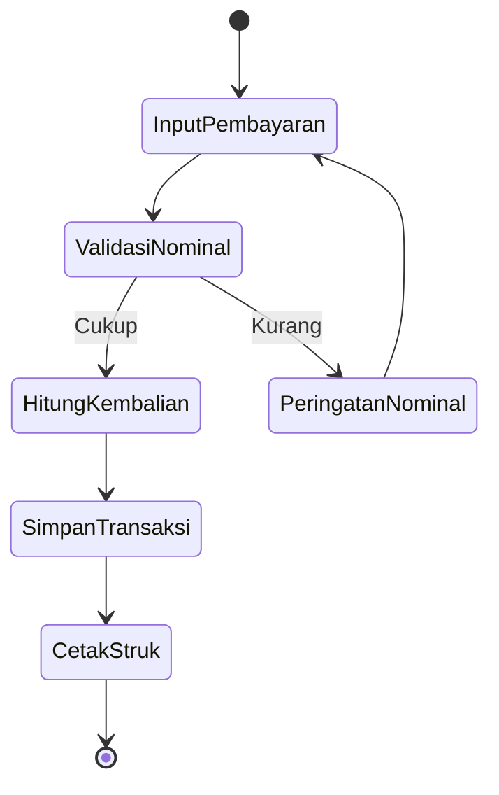

#### UI Design dan Deskripsi Objek UI #2
Antarmuka dialog pembayaran kasir dan struk pembayaran yang memuat QR Code unik.

#### Gambar 6: Modal Pembayaran Kasir & Cetak Struk (POS-02)
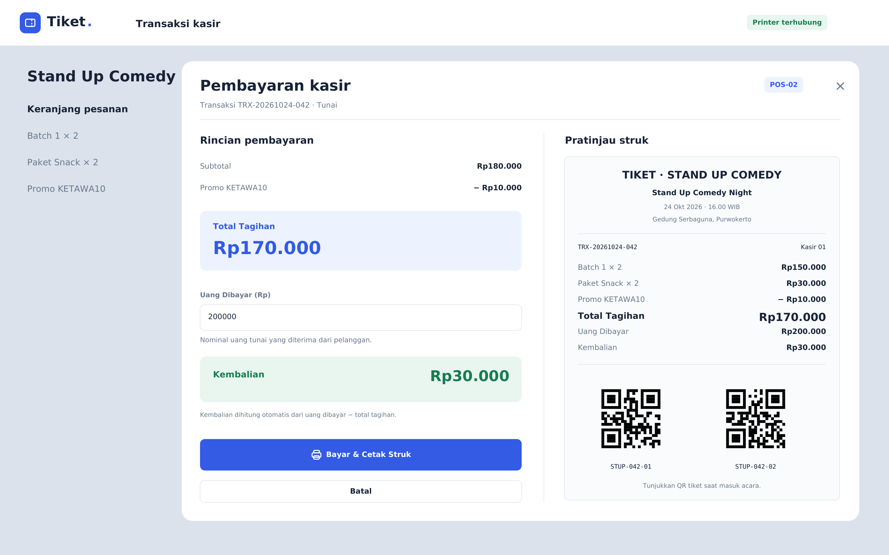  
*(Lokasi File UI Alternatif: `doc_tugas1/UI/1791434437699-5b2aadb6-c872-4e20-a07d-0862ff0852cd_2.jpg`)*

#### Tabel 7: Tabel Deskripsi Objek UI Modal Pembayaran Kasir & Cetak Struk (POS-02)
| ID LAYAR | NAMA LAYAR | DESKRIPSI |
|:---|:---|:---|
| **POS-02** | Modal Pembayaran Kasir | Modal untuk menginput nominal pembayaran tunai dan kalkulasi kembalian. |

#### Tabel 8: Spesifikasi Detail Antarmuka POS-02: Modal Pembayaran Kasir
| Id_Objek | JENIS | LABEL | Keterangan |
|:---|:---|:---|:---|
| `lblTotalTagihan` | Label | Total Tagihan | Menampilkan jumlah total yang harus dibayar. |
| `txtNominalBayar` | Textbox | Uang Dibayar | Menginput jumlah nominal uang tunai yang diterima. |
| `lblKembalian` | Label | Kembalian | Menampilkan selisih nilai kembalian uang secara otomatis. |
| `btnProsesCetak` | Button | Bayar & Cetak Struk | Menyimpan transaksi dan memicu pencetakan struk QR Code. |

#### Identifikasi Object dan Tipe Kelas #2
Identifikasi objek yang terkait dengan Use Case #2 Melakukan Pembayaran Kasir & Cetak Struk:

#### Tabel 9: Tabel Object Perancangan Use Case #2
| No | Nama Object Baru | Jenis / Tipe Kelas |
|:---|:---|:---|
| 1 | `PoSView` | Boundary (Interface) |
| 2 | `TransactionController` | Controller (Pemrosesan) |
| 3 | `TransactionEntity` | Entity (Basisdata) |
| 4 | `PrinterService` | Controller (Layanan Cetak) |

#### Gambar 7: Sequence Diagram Melakukan Pembayaran Kasir & Cetak Struk
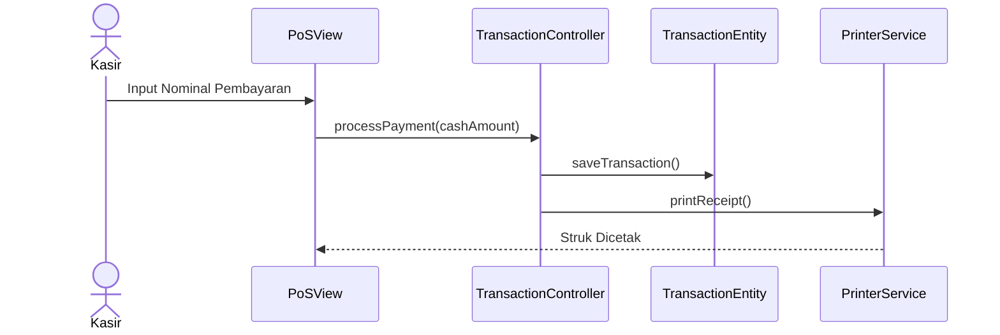

---

### 2.2.3 Use Case #3 Memesan Tiket Online (Self-Service)

#### Use Case Scenario #3
* **Pre-Condition**: Pengunjung mengakses portal web Storefront Sistem Pemesanan Tiket.
* **Use Case Description**: Pengunjung memilih kategori tiket, menentukan kuantitas pemesanan secara mandiri, dan memasukkan tiket ke keranjang belanja online sebelum checkout.
* **Primary Flow**: Pengunjung menjelajahi daftar tiket acara, memilih kuantitas, memilih 'Beli Tiket', dan sistem memasukkan tiket ke keranjang serta mengarahkan ke halaman ringkasan checkout.
* **Alternative Flow**: Kuantitas yang diminta melebihi sisa kuota yang tersedia, sistem menampilkan notifikasi kuota tidak mencukupi.
* **Post-Condition**: Item tiket tersimpan di keranjang pemesanan online pengunjung.

#### Gambar 8: Activity Diagram Memesan Tiket Online (Self-Service)
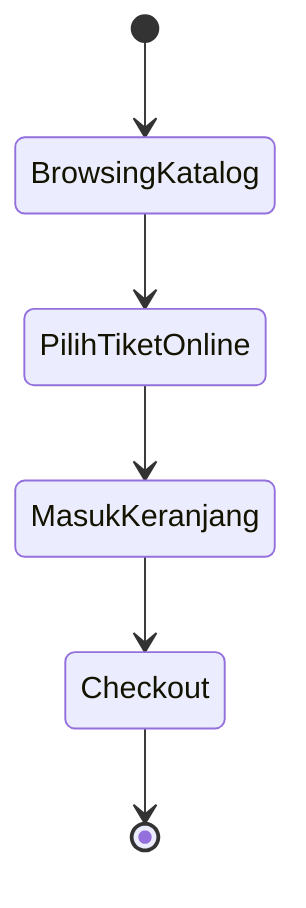

#### UI Design dan Deskripsi Objek UI #3
Antarmuka portal Web Storefront pemesanan tiket mandiri bagi pengunjung.

#### Gambar 9: UI Storefront Pemesanan Tiket Online (WEB-01)
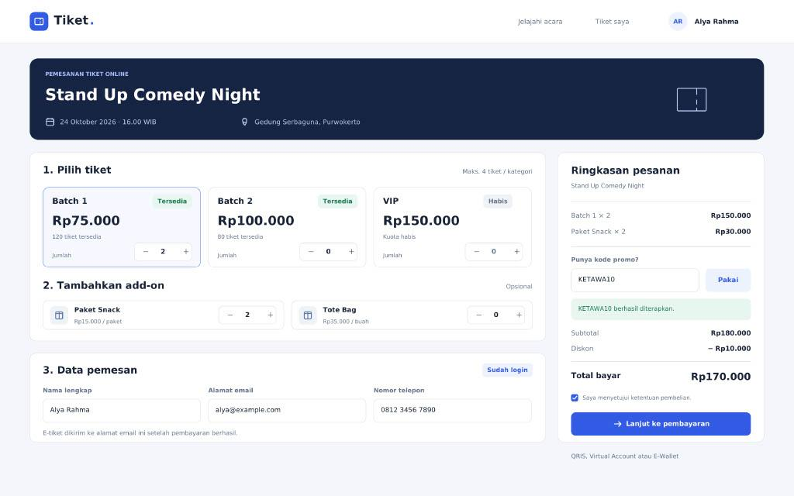  
*(Lokasi File UI Alternatif: `doc_tugas1/UI/09-mobile-pilih-tiket.png`)*

#### Tabel 10: Tabel Deskripsi Objek UI Storefront Pemesanan Tiket Online (WEB-01)
| ID LAYAR | NAMA LAYAR | DESKRIPSI |
|:---|:---|:---|
| **WEB-01** | Storefront Katalog Event | Halaman publik tempat pengunjung memilih tiket acara dan kuantitas pemesanan. |

#### Tabel 11: Spesifikasi Detail Antarmuka WEB-01: Storefront Katalog Event
| Id_Objek | JENIS | LABEL | Keterangan |
|:---|:---|:---|:---|
| `cardTicketTier` | Card View | Kategori Tiket | Menampilkan detail harga, nama tier, dan deskripsi tiket. |
| `numQty` | Number Input | Jumlah Tiket | Mengatur jumlah lembar tiket yang akan dibeli. |
| `btnAddToCart` | Button | Beli Sekarang | Memasukkan tiket pilihan ke keranjang belanja online. |

#### Identifikasi Object dan Tipe Kelas #3
Identifikasi objek yang terkait dengan Use Case #3 Memesan Tiket Online (Self-Service):

#### Tabel 12: Tabel Object Perancangan Use Case #3
| No | Nama Object Baru | Jenis / Tipe Kelas |
|:---|:---|:---|
| 1 | `StorefrontView` | Boundary (Interface) |
| 2 | `OrderController` | Controller (Pemrosesan) |
| 3 | `CartEntity` | Entity (Basisdata) |

#### Gambar 10: Sequence Diagram Memesan Tiket Online (Self-Service)
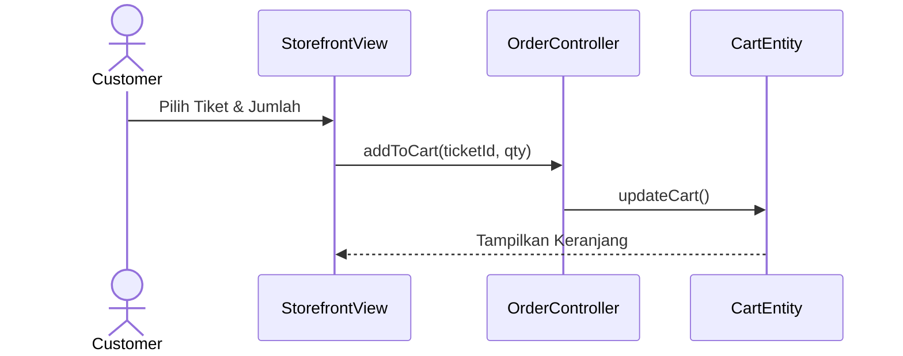

---

### 2.2.4 Use Case #4 Melakukan Pembayaran Payment Gateway

#### Use Case Scenario #4
* **Pre-Condition**: Pesanan online telah dibuat dan pengunjung berada di halaman checkout pembayaran.
* **Use Case Description**: Pengunjung melakukan pembayaran tagihan tiket melalui integrasi payment gateway digital (Virtual Account, QRIS, E-Wallet).
* **Primary Flow**: Pengunjung memilih metode pembayaran, sistem mengarahkan ke gateway, pembayaran terverifikasi sukses via callback, dan e-tiket dikirim via email.
* **Alternative Flow**: Pembayaran gagal atau melebihi batas waktu (expired), transaksi dibatalkan otomatis dan kuota dikembalikan.
* **Post-Condition**: Status transaksi berubah menjadi 'Paid' dan e-tiket PDF diterbitkan.

#### Gambar 11: Activity Diagram Melakukan Pembayaran Payment Gateway
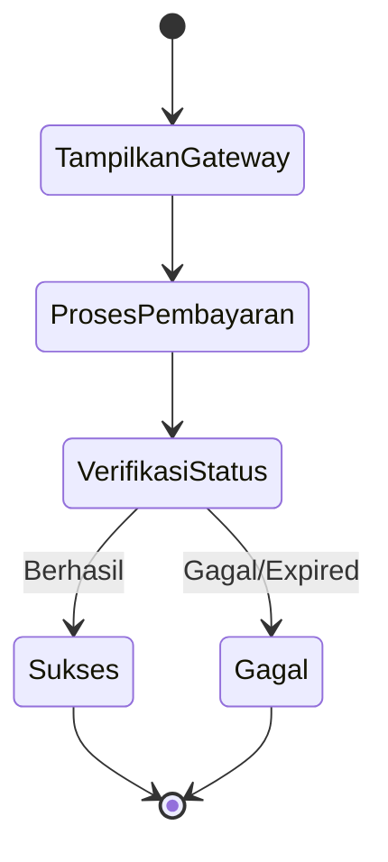

#### UI Design dan Deskripsi Objek UI #4
Antarmuka instruksi pembayaran online dan pemilihan metode Payment Gateway.

#### Gambar 12: UI Halaman Checkout Payment Gateway (PAY-01)
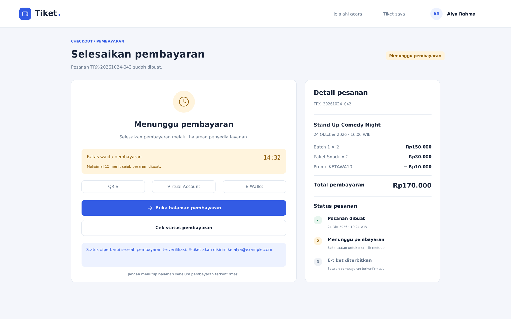  
*(Lokasi File UI Alternatif: `doc_tugas1/UI/10-mobile-checkout.png`)*

#### Tabel 13: Deskripsi Objek UI Halaman Checkout Payment Gateway (PAY-01)
| ID LAYAR | NAMA LAYAR | DESKRIPSI |
|:---|:---|:---|
| **PAY-01** | Page Payment Gateway | Halaman instruksi pembayaran dan pemilihan saluran Payment Gateway. |

#### Tabel 14: Spesifikasi Detail Antarmuka PAY-01: Page Payment Gateway
| Id_Objek | JENIS | LABEL | Keterangan |
|:---|:---|:---|:---|
| `radPaymentMethod` | Radio Button | Metode Pembayaran | Memilih saluran pembayaran (QRIS / VA / E-Wallet). |
| `btnPayNow` | Button | Buka halaman pembayaran | Mengirim permintaan transaksi ke Payment Gateway pihak ketiga. |

#### Identifikasi Object dan Tipe Kelas #4
Identifikasi objek yang terkait dengan Use Case #4 Melakukan Pembayaran Payment Gateway:

#### Tabel 15: Tabel Object Perancangan Use Case #4
| No | Nama Object Baru | Jenis / Tipe Kelas |
|:---|:---|:---|
| 1 | `PaymentPage` | Boundary (Interface) |
| 2 | `PaymentController` | Controller (Pemrosesan) |
| 3 | `PaymentEntity` | Entity (Basisdata) |

#### Gambar 13: Sequence Diagram Melakukan Pembayaran Payment Gateway
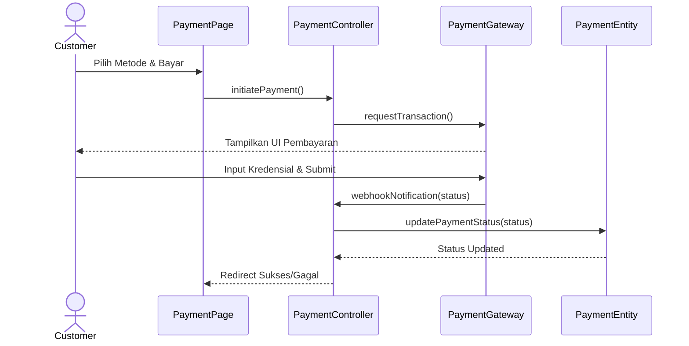

---

### 2.2.5 Use Case #5 Melakukan Validasi QR Code Tiket

#### Use Case Scenario #5
* **Pre-Condition**: Petugas gate telah membuka modul pemindai scanner check-in pada perangkat pembaca.
* **Use Case Description**: Petugas gate memindai QR code tiket pengunjung di pintu masuk acara untuk memverifikasi keabsahan tiket secara real-time.
* **Primary Flow**: Petugas mengarahkan scanner ke QR code e-tiket/struk, sistem memeriksa enkripsi data QR, mengonfirmasi status belum terpakai, dan memberikan indikator akses diterima.
* **Alternative Flow**: QR code tidak terdaftar atau sudah memiliki status checked-in sebelumnya, sistem membunyikan peringatan penolakan akses.
* **Post-Condition**: Keabsahan QR code tiket berhasil terverifikasi.

#### Gambar 14: Activity Diagram Melakukan Validasi QR Code Tiket
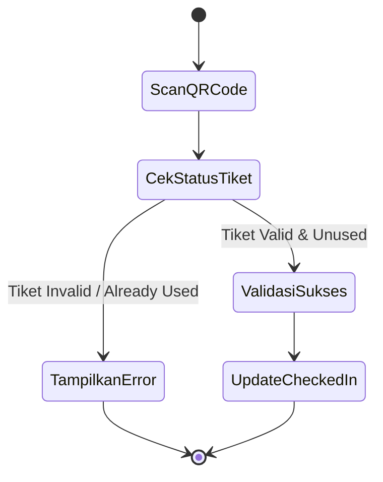

#### UI Design dan Deskripsi Objek UI #5
Antarmuka aplikasi kamera scanner pada gerbang masuk check-in acara.

#### Gambar 15: UI Antarmuka Validation Gate Scanner (GATE-01)
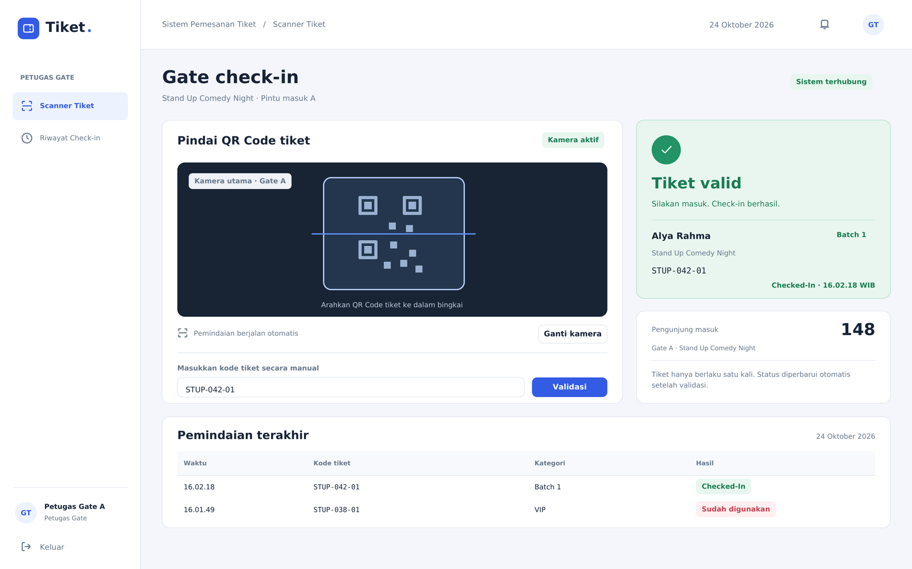  
*(Lokasi File UI Alternatif: `doc_tugas1/UI/11-mobile-status-pembayaran.png`)*

#### Tabel 16: Tabel Deskripsi Objek UI Antarmuka Validation Gate Scanner (GATE-01)
| ID LAYAR | NAMA LAYAR | DESKRIPSI |
|:---|:---|:---|
| **GATE-01** | Gate Scanner View | Tampilan pemindai QR Code tiket pada perangkat gate petugas. |

#### Tabel 17: Spesifikasi Detail Antarmuka GATE-01: Gate Scanner View
| Id_Objek | JENIS | LABEL | Keterangan |
|:---|:---|:---|:---|
| `camStream` | Camera View | Area Scanner | Menangkap feed video kamera untuk memindai QR Code. |
| `lblScanStatus` | Label | Status Pemindaian | Menampilkan hasil validasi QR Code secara visual. |

#### Identifikasi Object dan Tipe Kelas #5
Identifikasi objek yang terkait dengan Use Case #5 Melakukan Validasi QR Code Tiket:

#### Tabel 18: Tabel Object Perancangan Use Case #5
| No | Nama Object Baru | Jenis / Tipe Kelas |
|:---|:---|:---|
| 1 | `GateScannerView` | Boundary (Interface) |
| 2 | `ValidationController` | Controller (Pemrosesan) |
| 3 | `TicketEntity` | Entity (Basisdata) |

#### Gambar 16: Sequence Diagram Melakukan Validasi QR Code Tiket
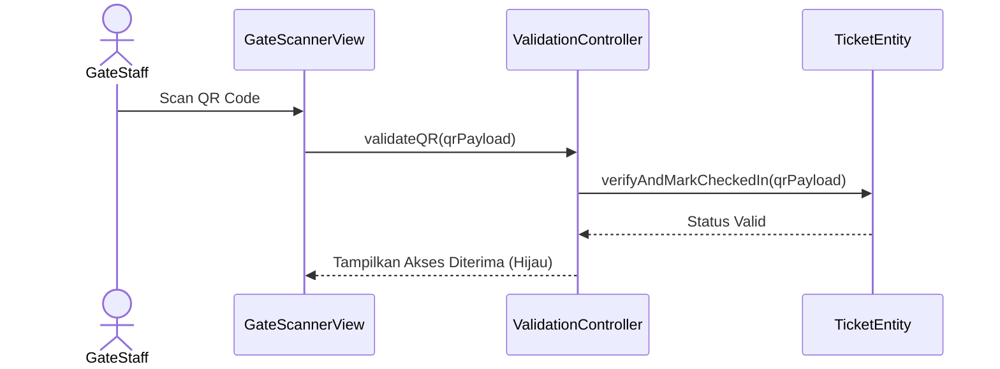

---

### 2.2.6 Use Case #6 Mengubah Status Checked-In

#### Use Case Scenario #6
* **Pre-Condition**: QR code tiket telah berhasil divalidasi dan dinyatakan sah oleh sistem.
* **Use Case Description**: Sistem secara otomatis mengubah status tiket menjadi 'Checked-In' serta mencatat timestamp waktu kehadiran fisik pengunjung.
* **Primary Flow**: Sistem mengeksekusi pembaruan record status tiket di basis data menjadi 'Checked-In', menyimpan timestamp kehadiran, dan mengembalikan konfirmasi sukses.
* **Alternative Flow**: Terjadi kegagalan koneksi basis data, sistem mencetak log error dan mencoba kembali pembaruan data.
* **Post-Condition**: Status tiket tersimpan permanen sebagai 'Checked-In' sehingga tidak dapat digunakan kembali.

#### Gambar 17: Activity Diagram Mengubah Status Checked-In
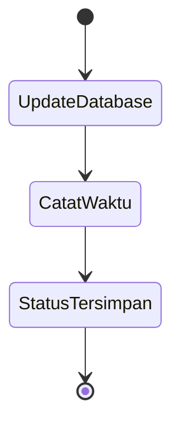

#### Identifikasi Object dan Tipe Kelas #6
Identifikasi objek yang terkait dengan Use Case #6 Mengubah Status Checked-In:

#### Tabel 19: Tabel Object Perancangan Use Case #6
| No | Nama Object Baru | Jenis / Tipe Kelas |
|:---|:---|:---|
| 1 | `ValidationController` | Controller (Pemrosesan) |
| 2 | `TicketEntity` | Entity (Basisdata) |

#### Gambar 18: Sequence Diagram Mengubah Status Checked-In
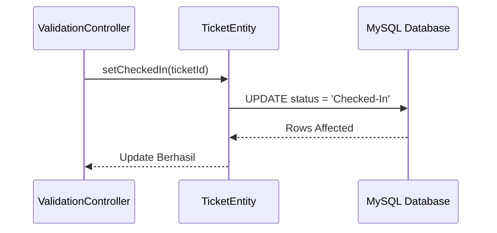

---

### 2.2.7 Use Case #7 Mengelola Master Event & Kuota

#### Use Case Scenario #7
* **Pre-Condition**: Administrator telah melakukan login dan membuka dasbor admin.
* **Use Case Description**: Administrator menambah, memperbarui, atau menghapus master data event, alokasi kuota tiket per tier, serta harga tiket.
* **Primary Flow**: Admin menginput data rincian event dan alokasi kuota per tier tiket, menekan tombol simpan, dan sistem memperbarui data di basis data.
* **Alternative Flow**: Form data event belum lengkap atau nilai kuota bernilai negatif, sistem menampilkan peringatan validasi form.
* **Post-Condition**: Master data event dan kuota tiket berhasil diperbarui.

#### Gambar 19: Activity Diagram Mengelola Master Event & Kuota


#### UI Design dan Deskripsi Objek UI #7
Antarmuka dasbor pengelolaan master data event dan alokasi kuota tiket oleh Admin.

#### Gambar 20: UI Dasbor Admin Kelola Master Event & Kuota (ADM-01)
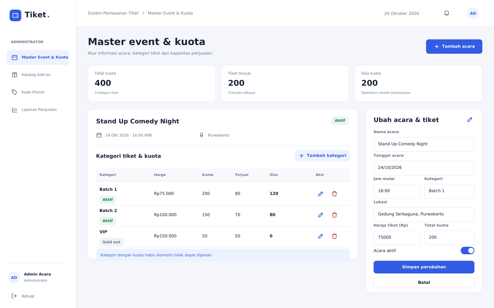  
*(Lokasi File UI Alternatif: `doc_tugas1/UI/1791434437699-5b2aadb6-c872-4e20-a07d-0862ff0852cd_3.jpg`)*

#### Tabel 20: Tabel Deskripsi Objek UI Dasbor Admin Kelola Master Event & Kuota (ADM-01)
| ID LAYAR | NAMA LAYAR | DESKRIPSI |
|:---|:---|:---|
| **ADM-01** | Admin Master Event View | Halaman dasbor manajemen jadwal event, tier tiket, dan kuota. |

#### Tabel 21: Spesifikasi Detail Antarmuka ADM-01: Admin Master Event View
| Id_Objek | JENIS | LABEL | Keterangan |
|:---|:---|:---|:---|
| `txtEventName` | Textbox | Nama Event | Menginput judul/nama acara pertunjukan. |
| `txtQuotaTier` | Textbox | Alokasi Kuota | Menginput batas alokasi kuota tiket per tier. |
| `btnSaveEvent` | Button | Simpan Event | Menyimpan perubahan master event ke database. |

#### Identifikasi Object dan Tipe Kelas #7
Identifikasi objek yang terkait dengan Use Case #7 Mengelola Master Event & Kuota:

#### Tabel 22: Tabel Object Perancangan Use Case #7
| No | Nama Object Baru | Jenis / Tipe Kelas |
|:---|:---|:---|
| 1 | `AdminEventView` | Boundary (Interface) |
| 2 | `EventController` | Controller (Pemrosesan) |
| 3 | `EventEntity` | Entity (Basisdata) |

#### Gambar 21: Sequence Diagram Mengelola Master Event & Kuota
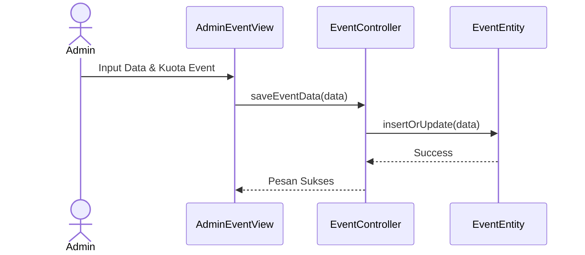

---

### 2.2.8 Use Case #8 Mengelola Katalog Add-on

#### Use Case Scenario #8
* **Pre-Condition**: Administrator berada di dasbor manajemen katalog produk.
* **Use Case Description**: Administrator mengelola katalog produk add-on (snack/merchandise), mencakup pembaruan harga satuan dan ketersediaan stok.
* **Primary Flow**: Admin memasukkan data produk add-on baru, menetapkan harga dan kuantitas stok, lalu menyimpan perubahan ke katalog sistem.
* **Alternative Flow**: Input harga atau jumlah stok bernilai negatif, sistem menampilkan peringatan kesalahan input.
* **Post-Condition**: Data katalog add-on berhasil diperbarui.

#### Gambar 22: Activity Diagram Mengelola Katalog Add-on
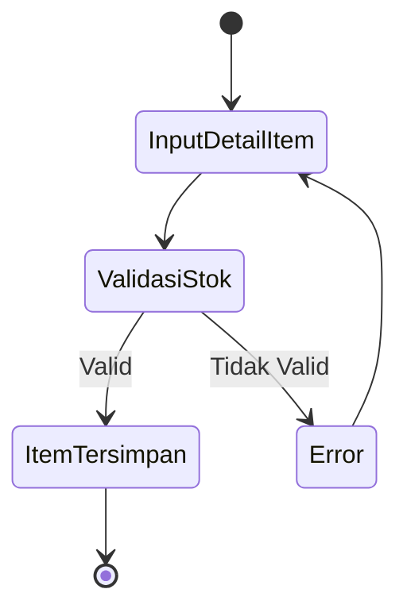

#### UI Design dan Deskripsi Objek UI #8
Antarmuka dasbor pengelolaan produk pelengkap (add-on) oleh Admin.

#### Gambar 23: UI Dasbor Admin Kelola Katalog Add-on (ADM-02)
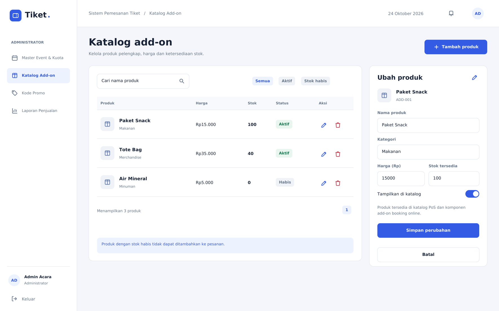  
*(Lokasi File UI Alternatif: `doc_tugas1/UI/1791434437699-5b2aadb6-c872-4e20-a07d-0862ff0852cd_4.jpg`)*

#### Tabel 23: Tabel Deskripsi Objek UI Dasbor Admin Kelola Katalog Add-on (ADM-02)
| ID LAYAR | NAMA LAYAR | DESKRIPSI |
|:---|:---|:---|
| **ADM-02** | Admin Add-on View | Halaman pengelolaan item add-on, harga, dan ketersediaan stok. |

#### Tabel 24: Spesifikasi Detail Antarmuka ADM-02: Admin Add-on View
| Id_Objek | JENIS | LABEL | Keterangan |
|:---|:---|:---|:---|
| `txtAddonName` | Textbox | Nama Add-on | Menginput nama produk merchandise/snack. |
| `txtAddonPrice` | Textbox | Harga Satuan | Menginput harga per unit item add-on. |
| `btnSaveAddon` | Button | Simpan Add-on | Menyimpan data add-on baru ke basis data. |

#### Identifikasi Object dan Tipe Kelas #8
Identifikasi objek yang terkait dengan Use Case #8 Mengelola Katalog Add-on:

#### Tabel 25: Tabel Object Perancangan Use Case #8
| No | Nama Object Baru | Jenis / Tipe Kelas |
|:---|:---|:---|
| 1 | `AdminAddonView` | Boundary (Interface) |
| 2 | `AddonController` | Controller (Pemrosesan) |
| 3 | `AddonEntity` | Entity (Basisdata) |

#### Gambar 24: Sequence Diagram Mengelola Katalog Add-on
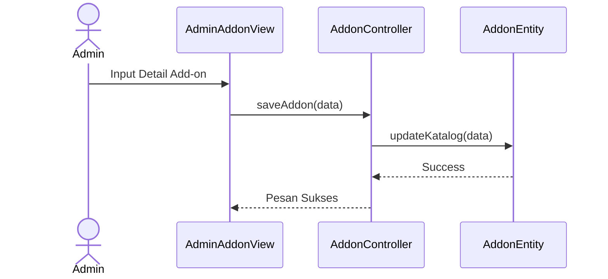

---

### 2.2.9 Use Case #9 Mengelola Kode Promo

#### Use Case Scenario #9
* **Pre-Condition**: Administrator telah berada di halaman pengaturan voucher promo.
* **Use Case Description**: Administrator membuat voucher diskon baru, menentukan besaran potongan, syarat minimum transaksi, masa aktif, dan kuota promo.
* **Primary Flow**: Admin mengisi kode kupon unik, nominal/persentase diskon, dan rentang tanggal berlaku, lalu menyimpan voucher ke sistem.
* **Alternative Flow**: Kode promo yang diinput sudah ada (duplikat), sistem menolak pembuatan promo.
* **Post-Condition**: Kode promo aktif dan siap diklaim oleh pembeli.

#### Gambar 25: Activity Diagram Mengelola Kode Promo
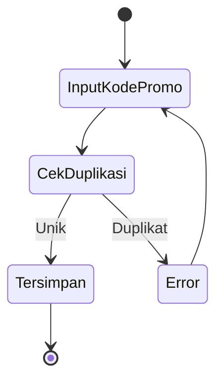

#### UI Design dan Deskripsi Objek UI #9
Antarmuka dasbor pembuat dan pengelola kode kupon promo oleh Admin.

#### Gambar 26: UI Dasbor Admin Kelola Kode Promo (ADM-03)
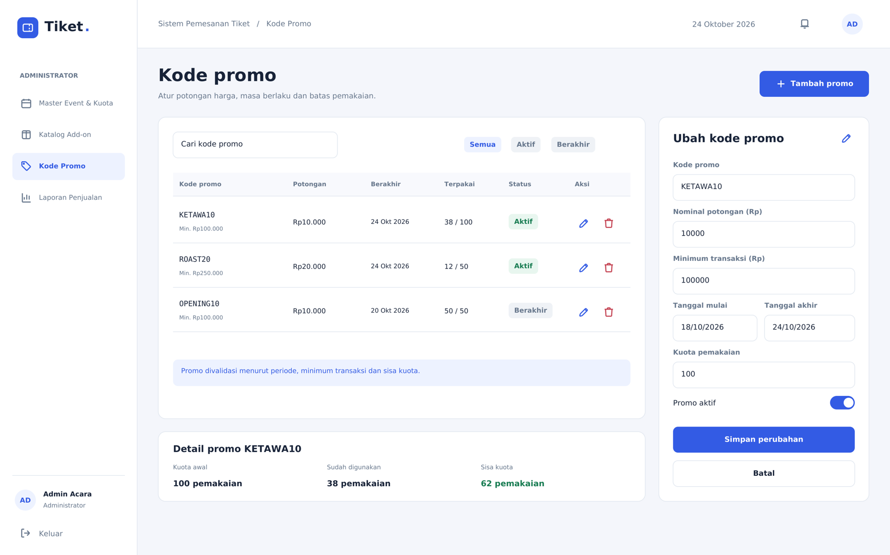  
*(Lokasi File UI Alternatif: `doc_tugas1/UI/1791434437699-5b2aadb6-c872-4e20-a07d-0862ff0852cd_5.jpg`)*

#### Tabel 26: Tabel Deskripsi Objek UI Dasbor Admin Kelola Kode Promo (ADM-03)
| ID LAYAR | NAMA LAYAR | DESKRIPSI |
|:---|:---|:---|
| **ADM-03** | Admin Promo View | Halaman pengelolaan voucher promo, syarat transaksi, dan kuota pemakaian. |

#### Tabel 27: Spesifikasi Detail Antarmuka ADM-03: Admin Promo View
| Id_Objek | JENIS | LABEL | Keterangan |
|:---|:---|:---|:---|
| `txtPromoCode` | Textbox | Kode Promo | Menginput string unik kode kupon promo. |
| `txtDiscountValue` | Textbox | Nilai Diskon | Menginput besaran potongan harga. |
| `btnSavePromo` | Button | Simpan Promo | Menyimpan data voucher promo ke basis data. |

#### Identifikasi Object dan Tipe Kelas #9
Identifikasi objek yang terkait dengan Use Case #9 Mengelola Kode Promo:

#### Tabel 28: Tabel Object Perancangan Use Case #9
| No | Nama Object Baru | Jenis / Tipe Kelas |
|:---|:---|:---|
| 1 | `AdminPromoView` | Boundary (Interface) |
| 2 | `PromoController` | Controller (Pemrosesan) |
| 3 | `PromoEntity` | Entity (Basisdata) |

#### Gambar 27: Sequence Diagram Mengelola Kode Promo
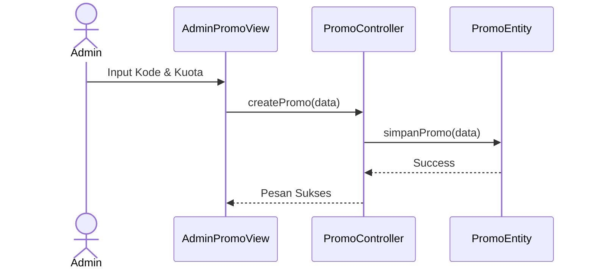

---

### 2.2.10 Use Case #10 Memilih Produk Add-on

#### Use Case Scenario #10
* **Pre-Condition**: Pembeli sedang memilih tiket di PoS atau Storefront online.
* **Use Case Description**: Pembeli secara opsional menambahkan item produk add-on (snack/merchandise) ke dalam transaksi pemesanan.
* **Primary Flow**: Pembeli memilih opsi produk add-on, menentukan jumlah item, sistem mengonfirmasi ketersediaan stok, dan menambahkan ke total tagihan.
* **Alternative Flow**: Stok item add-on habis, sistem menonaktifkan opsi pemilihan item tersebut.
* **Post-Condition**: Item add-on masuk ke keranjang belanja dan total tagihan ter-update.

#### Gambar 28: Activity Diagram Memilih Produk Add-on
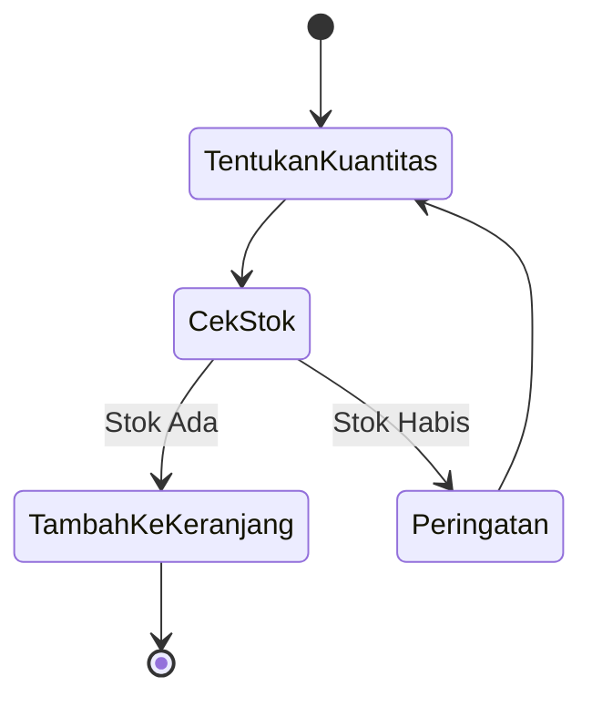

#### UI Design dan Deskripsi Objek UI #10
Antarmuka modal pop-up pemilihan barang add-on bagi pembeli.

#### Gambar 29: UI Modal Pemilihan Produk Add-on (Kasir)
  
*(Lokasi File UI Alternatif: `doc_tugas1/UI/1791434437699-5b2aadb6-c872-4e20-a07d-0862ff0852cd_1.jpg`)*

#### Gambar 30: UI Modal Pemilihan Produk Add-on (Customer)
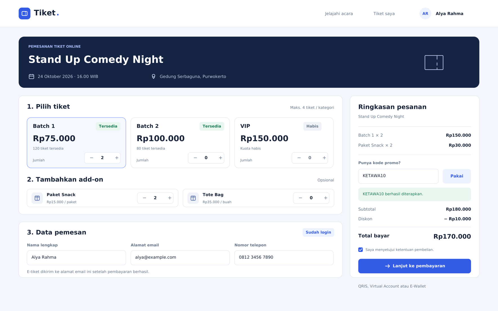  
*(Lokasi File UI Alternatif: `doc_tugas1/UI/09-mobile-pilih-tiket.png`)*

#### Tabel 29: Tabel Deskripsi Objek UI Modal Pemilihan Produk Add-on
| ID LAYAR | NAMA LAYAR | DESKRIPSI |
|:---|:---|:---|
| **MOD-01** | Add-on Selector Modal | Pop-up antarmuka untuk memilih merchandise/snack tambahan. |

#### Tabel 30: Spesifikasi Detail Antarmuka MOD-01: Add-on Selector Modal
| Id_Objek | JENIS | LABEL | Keterangan |
|:---|:---|:---|:---|
| `chkAddonItem` | Checkbox | Pilih Item | Memilih jenis item add-on yang diinginkan. |
| `numAddonQty` | Number Input | Jumlah | Mengatur kuantitas item add-on. |
| `btnConfirmAddon` | Button | Konfirmasi | Memasukkan item add-on pilihan ke keranjang. |

#### Identifikasi Object dan Tipe Kelas #10
Identifikasi objek yang terkait dengan Use Case #10 Memilih Produk Add-on:

#### Tabel 31: Tabel Object Perancangan Use Case #10
| No | Nama Object Baru | Jenis / Tipe Kelas |
|:---|:---|:---|
| 1 | `AddonSelectorModal` | Boundary (Interface) |
| 2 | `OrderController` | Controller (Pemrosesan) |
| 3 | `AddonEntity` | Entity (Basisdata) |

#### Gambar 31: Sequence Diagram Memilih Produk Add-on (Kasir)
```mermaid
sequenceDiagram
    actor Kasir
    participant AddonSelectorModal
    participant OrderController
    participant AddonEntity
    Kasir->>AddonSelectorModal: Pilih Add-on & Kty
    AddonSelectorModal->>OrderController: addAddon(id, qty)
    OrderController->>AddonEntity: checkStok(id, qty)
    AddonEntity-->>OrderController: Stok Valid
    OrderController-->>AddonSelectorModal: Update Keranjang
```

#### Gambar 32: Sequence Diagram Memilih Produk Add-on (Customer)
```mermaid
sequenceDiagram
    actor Customer
    participant AddonSelectorModal
    participant OrderController
    participant AddonEntity
    Customer->>AddonSelectorModal: Pilih Add-on & Kty
    AddonSelectorModal->>OrderController: addAddon(id, qty)
    OrderController->>AddonEntity: checkStok(id, qty)
    AddonEntity-->>OrderController: Stok Valid
    OrderController-->>AddonSelectorModal: Update Keranjang
```

---

### 2.2.11 Use Case #11 Menerapkan Kode Promo

#### Use Case Scenario #11
* **Pre-Condition**: Pembeli berada di halaman rincian transaksi keranjang atau checkout.
* **Use Case Description**: Pembeli memasukkan kode voucher promo untuk klaim potongan harga tagihan transaksi.
* **Primary Flow**: Pembeli memasukkan kode kupon, sistem mengonfirmasi syarat minimum transaksi dan tanggal berlaku, lalu memotong total tagihan secara otomatis.
* **Alternative Flow**: Kode promo tidak valid, expired, atau kuota habis, sistem menampilkan notifikasi penolakan voucher.
* **Post-Condition**: Potongan harga promo berhasil diterapkan pada total akhir transaksi.

#### Gambar 33: Activity Diagram Menerapkan Kode Promo
```mermaid
stateDiagram-v2
    [*] --> InputKode
    InputKode --> SistemValidasi
    SistemValidasi --> TerapkanDiskon: Valid
    SistemValidasi --> Tolak: Invalid
    Tolak --> [*]
    TerapkanDiskon --> [*]
```

#### UI Design dan Deskripsi Objek UI #11
Antarmuka komponen input kode promo pada halaman transaksi.

#### Gambar 34: UI Komponen Input Kode Promo (Kasir)
  
*(Lokasi File UI Alternatif: `doc_tugas1/UI/1791434437699-5b2aadb6-c872-4e20-a07d-0862ff0852cd_1.jpg`)*

#### Gambar 35: UI Komponen Input Kode Promo (Customer)
  
*(Lokasi File UI Alternatif: `doc_tugas1/UI/10-mobile-checkout.png`)*

#### Tabel 32: Tabel Deskripsi Objek UI Komponen Input Kode Promo
| ID LAYAR | NAMA LAYAR | DESKRIPSI |
|:---|:---|:---|
| **CMP-01** | Promo Input Component | Komponen masukan kode kupon promo pada checkout transaksi. |

#### Tabel 33: Spesifikasi Detail Antarmuka CMP-01: Promo Input Component
| Id_Objek | JENIS | LABEL | Keterangan |
|:---|:---|:---|:---|
| `txtInputVoucher` | Textbox | Kode Voucher | Menginput string kode promo. |
| `btnApplyVoucher` | Button | Gunakan | Memvalidasi dan mengaplikasikan diskon ke total tagihan. |

#### Identifikasi Object dan Tipe Kelas #11
Identifikasi objek yang terkait dengan Use Case #11 Menerapkan Kode Promo:

#### Tabel 34: Tabel Object Perancangan Use Case #11
| No | Nama Object Baru | Jenis / Tipe Kelas |
|:---|:---|:---|
| 1 | `PromoInputComponent` | Boundary (Interface) |
| 2 | `PromoController` | Controller (Pemrosesan) |
| 3 | `PromoEntity` | Entity (Basisdata) |

#### Gambar 36: Sequence Diagram Menerapkan Kode Promo
```mermaid
sequenceDiagram
    actor Customer
    participant PromoInputComponent
    participant PromoController
    participant PromoEntity
    Customer->>PromoInputComponent: Input Kode Promo
    PromoInputComponent->>PromoController: applyPromo(kode)
    PromoController->>PromoEntity: validatePromo(kode)
    PromoEntity-->>PromoController: Promo Valid
    PromoController-->>PromoInputComponent: Diskon Diterapkan
```

---

### 2.2.12 Use Case #12 Mengakses Laporan Penjualan

#### Use Case Scenario #12
* **Pre-Condition**: Administrator telah masuk ke sistem dasbor manajemen.
* **Use Case Description**: Administrator mengakses rekapitulasi grafik penjualan, melihat statistik tiket terjual, dan mengekspor laporan transaksi ke format spreadsheet/PDF.
* **Primary Flow**: Admin membuka menu Laporan Penjualan, menentukan rentang tanggal, sistem mengkueri transaksi dan menampilkan visualisasi grafik serta rekapitulasi data.
* **Alternative Flow**: Tidak ada transaksi pada rentang tanggal yang dipilih, grafik menampilkan status data kosong.
* **Post-Condition**: Laporan penjualan berhasil ditampilkan dan diunduh dalam bentuk file ekspor.

#### Gambar 37: Activity Diagram Mengakses Laporan Penjualan
```mermaid
stateDiagram-v2
    [*] --> PilihFilterWaktu
    PilihFilterWaktu --> TampilkanGrafik
    TampilkanGrafik --> EksporData
    EksporData --> [*]
```

#### UI Design dan Deskripsi Objek UI #12
Antarmuka dasbor laporan penjualan dan grafik statistik transaksi bagi Admin.

#### Gambar 38: UI Dasbor Admin Laporan Penjualan (ADM-04)
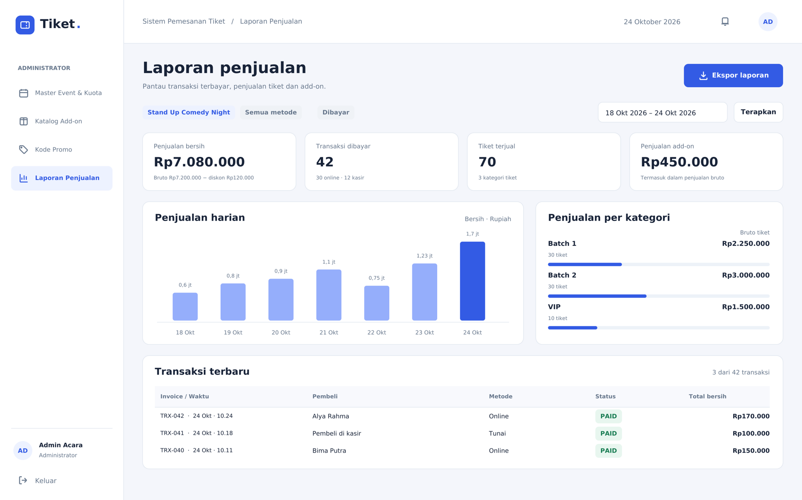  
*(Lokasi File UI Alternatif: `doc_tugas1/UI/1791434437699-5b2aadb6-c872-4e20-a07d-0862ff0852cd_6.jpg`)*

#### Tabel 35: Tabel Deskripsi Objek UI Dasbor Admin Laporan Penjualan
| ID LAYAR | NAMA LAYAR | DESKRIPSI |
|:---|:---|:---|
| **ADM-04** | Admin Sales Report View | Dasbor visualisasi grafik dan tabel rekapitulasi penjualan tiket. |

#### Tabel 36: Spesifikasi Detail Antarmuka ADM-04: Admin Sales Report View
| Id_Objek | JENIS | LABEL | Keterangan |
|:---|:---|:---|:---|
| `dtpDateRange` | Date Picker | Rentang Tanggal | Memilih periode waktu laporan penjualan. |
| `chartSales` | Chart Widget | Grafik Penjualan | Menampilkan tren pendapatan dan volume tiket terjual. |
| `btnExportReport` | Button | Ekspor Laporan | Mengekspor data transaksi ke file Excel/PDF. |

#### Identifikasi Object dan Tipe Kelas #12
Identifikasi objek yang terkait dengan Use Case #12 Mengakses Laporan Penjualan:

#### Tabel 37: Tabel Object Perancangan Use Case #12
| No | Nama Object Baru | Jenis / Tipe Kelas |
|:---|:---|:---|
| 1 | `ReportDashboardView` | Boundary (Interface) |
| 2 | `ReportController` | Controller (Pemrosesan) |
| 3 | `TransactionEntity` | Entity (Basisdata) |

#### Gambar 39: Sequence Diagram Mengakses Laporan Penjualan
```mermaid
sequenceDiagram
    actor Admin
    participant ReportDashboardView
    participant ReportController
    participant TransactionEntity
    Admin->>ReportDashboardView: Pilih Filter Waktu
    ReportDashboardView->>ReportController: fetchReportData()
    ReportController->>TransactionEntity: queryTransactions()
    TransactionEntity-->>ReportController: Data Laporan
    ReportController-->>ReportDashboardView: Tampilkan Grafik
```

---

### 2.3 Perancangan Basis Data (ERD)

Berikut adalah **Entity Relationship Diagram (ERD)** dari Sistem Pemesanan Tiket:

#### Gambar 40: Entity Relationship Diagram (ERD)
```mermaid
erDiagram
    PENGGUNA ||--o{ TRANSAKSI : melayani_atau_memproses
    PENGGUNA {
        int id PK
        string username
        string password_hash
        string role
    }

    PROMO ||--o{ TRANSAKSI : digunakan_pada
    PROMO {
        string kode_promo PK
        int nominal_potongan
        int kuota_promo
        date tanggal_kadaluarsa
    }

    TRANSAKSI ||--|{ TRANSAKSI_DETAIL : memiliki
    TRANSAKSI {
        string no_invoice PK
        datetime waktu_transaksi
        int id_pengguna FK "Nullable jika self-service"
        string kode_promo FK "Nullable jika tanpa promo"
        string nama_pemesan
        string email_pemesan
        string no_telp_pemesan
        string metode_pembayaran "CASH, QRIS, VA"
        string status_transaksi "PENDING, PAID, EXPIRED"
        int total_bayar
        int nominal_kembalian
    }

    TIKET ||--o{ TRANSAKSI_DETAIL : dipesan_dalam
    TIKET {
        int id PK
        string tier
        int harga
        int sisa_kuota
    }

    ADDON ||--o{ TRANSAKSI_DETAIL : dipesan_dalam
    ADDON {
        int id PK
        string nama_item
        int harga
        int stok
    }

    TRANSAKSI_DETAIL ||--o{ TIKET_ITEM : menerbitkan
    TRANSAKSI_DETAIL {
        int id_detail PK
        string no_invoice FK
        int id_tiket FK "Nullable jika item addon"
        int id_addon FK "Nullable jika item tiket"
        int kuantitas
        int subtotal
    }

    TIKET_ITEM {
        string kode_tiket PK
        int id_detail FK
        string qr_code_hash
        string status_kehadiran "Belum Hadir, Checked-In"
        datetime waktu_checkin
    }
```

---

### 2.4 Diagram Kelas Keseluruhan

Berikut merupakan rancangan diagram kelas keseluruhan yang merepresentasikan hubungan antara **Boundary**, **Controller**, dan **Entity** pada Sistem Pemesanan Tiket menggunakan arsitektur Model-View-Controller (MVC):

#### Gambar 41: Diagram Kelas Keseluruhan
```mermaid
classDiagram
    class PoSView {
        -cmbTiket
        -txtKuantitas
        -btnTambah
        -tblKeranjang
        +render()
    }
    class StorefrontView {
        -cardTicketTier
        -numQty
        -btnAddToCart
        +render()
    }
    class PaymentPage {
        -radPaymentMethod
        -btnPayNow
        +render()
    }
    class GateScannerView {
        -camStream
        -lblScanStatus
        +render()
    }
    class AdminDashboardView {
        -txtEventName
        -txtQuotaTier
        -btnSaveEvent
        +render()
    }
    class TransactionController {
        -TransaksiEntity transactionModel
        -TiketEntity ticketModel
        +addItem(ticketId, qty)
        +processPayment(cashAmount)
    }
    class OrderController {
        -TiketEntity ticketModel
        -TransaksiEntity transactionModel
        +addToCart(ticketId, qty)
    }
    class PaymentController {
        -TransaksiEntity transactionModel
        +initiatePayment()
        +webhookNotification(status)
    }
    class ValidationController {
        -TiketItemEntity tiketItemModel
        +validateQR(qrPayload)
        +setCheckedIn(ticketId)
    }
    class EventController {
        -TiketEntity ticketModel
        +saveEventData(data)
    }
    class AddonController {
        -AddonEntity addonModel
        +saveAddon(data)
    }
    class PromoController {
        -PromoEntity promoModel
        +createPromo(data)
        +applyPromo(kode)
    }
    class ReportController {
        -TransaksiEntity transactionModel
        +fetchReportData()
    }
    class PenggunaEntity {
        -int id
        -string username
        -string password_hash
        -string role
        +login()
        +logout()
    }
    class TransaksiEntity {
        -string no_invoice
        -datetime waktu_transaksi
        -int id_pengguna
        -string kode_promo
        -string nama_pemesan
        -string email_pemesan
        -string no_telp_pemesan
        -string metode_pembayaran
        -string status_transaksi
        -int total_bayar
        -int nominal_kembalian
        +saveTransaction()
        +updateStatus()
    }
    class TransaksiDetailEntity {
        -int id_detail
        -string no_invoice
        -int id_tiket
        -int id_addon
        -int kuantitas
        -int subtotal
        +addDetail()
        +calculateSubtotal()
    }
    class TiketEntity {
        -int id
        -string tier
        -int harga
        -int sisa_kuota
        +checkQuota(ticketId, qty)
        -updateQuota()
    }
    class AddonEntity {
        -int id
        -string nama_item
        -int harga
        -int stok
        +checkStok(id, qty)
        -updateStok()
    }
    class TiketItemEntity {
        -string kode_tiket
        -int id_detail
        -string qr_code_hash
        -string status_kehadiran
        -datetime waktu_checkin
        +verifyAndMarkCheckedIn(qrPayload)
    }
    class PromoEntity {
        -string kode_promo
        -int nominal_potongan
        -int kuota_promo
        -date tanggal_kadaluarsa
        +validatePromo(kode)
        -decrementKuota()
    }

    PoSView ..> TransactionController : uses
    StorefrontView ..> OrderController : uses
    PaymentPage ..> PaymentController : uses
    GateScannerView ..> ValidationController : uses
    AdminDashboardView ..> EventController : uses
    AdminDashboardView ..> AddonController : uses
    AdminDashboardView ..> PromoController : uses
    AdminDashboardView ..> ReportController : uses

    TransactionController --> TransaksiEntity : controls
    TransactionController --> TiketEntity : checks
    OrderController --> TransaksiEntity : controls
    OrderController --> TiketEntity : checks
    PaymentController --> TransaksiEntity : updates
    ValidationController --> TiketItemEntity : updates
    EventController --> TiketEntity : manages
    AddonController --> AddonEntity : manages
    PromoController --> PromoEntity : manages
    ReportController --> TransaksiEntity : queries

    PenggunaEntity "1" --o "0..*" TransaksiEntity : processes
    PromoEntity "0..1" --o "0..*" TransaksiEntity : applied_to
    TransaksiEntity "1" *-- "1..*" TransaksiDetailEntity : contains
    TiketEntity "0..1" --o "0..*" TransaksiDetailEntity : ordered_in
    AddonEntity "0..1" --o "0..*" TransaksiDetailEntity : ordered_in
    TransaksiDetailEntity "1" *-- "0..*" TiketItemEntity : generates
```

---

### 2.5 Perancangan Detil Kelas

Bagian ini memuat daftar keseluruhan kelas yang diimplementasikan dalam perangkat lunak menggunakan arsitektur Model-View-Controller (MVC):

#### Tabel 38: Perancangan Detil Kelas
| ID Kelas | Nama Kelas Perancangan | Atribute (visibility) | Method / Operation |
|:---|:---|:---|:---|
| **CLS-01** | `PenggunaEntity` | `-int id`<br>`-string username`<br>`-string password_hash`<br>`-string role` | `+login()`<br>`+logout()` |
| **CLS-02** | `TransaksiEntity` | `-string no_invoice`<br>`-datetime waktu_transaksi`<br>`-int id_pengguna`<br>`-string kode_promo`<br>`-string nama_pemesan`<br>`-string email_pemesan`<br>`-string no_telp_pemesan`<br>`-string metode_pembayaran`<br>`-string status_transaksi`<br>`-int total_bayar`<br>`-int nominal_kembalian` | `+saveTransaction()`<br>`+updateStatus()` |
| **CLS-03** | `TransaksiDetailEntity` | `-int id_detail`<br>`-string no_invoice`<br>`-int id_tiket`<br>`-int id_addon`<br>`-int kuantitas`<br>`-int subtotal` | `+addDetail()`<br>`+calculateSubtotal()` |
| **CLS-04** | `TiketEntity` | `-int id`<br>`-string tier`<br>`-int harga`<br>`-int sisa_kuota` | `+checkQuota(ticketId, qty)`<br>`-updateQuota()` |
| **CLS-05** | `AddonEntity` | `-int id`<br>`-string nama_item`<br>`-int harga`<br>`-int stok` | `+checkStok(id, qty)`<br>`-updateStok()` |
| **CLS-06** | `TiketItemEntity` | `-string kode_tiket`<br>`-int id_detail`<br>`-string qr_code_hash`<br>`-string status_kehadiran`<br>`-datetime waktu_checkin` | `+verifyAndMarkCheckedIn(qrPayload)` |
| **CLS-07** | `PromoEntity` | `-string kode_promo`<br>`-int nominal_potongan`<br>`-int kuota_promo`<br>`-date tanggal_kadaluarsa` | `+validatePromo(kode)`<br>`-decrementKuota()` |
| **CLS-08** | `TransactionController` | `-TransaksiEntity transactionModel`<br>`-TiketEntity ticketModel` | `+addItem(ticketId, qty)`<br>`+processPayment(cashAmount)` |
| **CLS-09** | `OrderController` | `-TiketEntity ticketModel`<br>`-TransaksiEntity transactionModel` | `+addToCart(ticketId, qty)` |
| **CLS-10** | `PaymentController` | `-TransaksiEntity transactionModel` | `+initiatePayment()`<br>`+webhookNotification(status)` |
| **CLS-11** | `ValidationController` | `-TiketItemEntity tiketItemModel` | `+validateQR(qrPayload)`<br>`+setCheckedIn(ticketId)` |
| **CLS-12** | `EventController` | `-TiketEntity ticketModel` | `+saveEventData(data)` |
| **CLS-13** | `AddonController` | `-AddonEntity addonModel` | `+saveAddon(data)` |
| **CLS-14** | `PromoController` | `-PromoEntity promoModel` | `+createPromo(data)`<br>`+applyPromo(kode)` |
| **CLS-15** | `ReportController` | `-TransaksiEntity transactionModel` | `+fetchReportData()` |

---

## BAB III MATRIKS KERUNUTAN (REQUIREMENT TRACEABILITY MATRIX)

Matriks kerunutan berikut memetakan keterkaitan langsung antara Kebutuhan Fungsional (*Functional Requirement*) pada dokumen SKPL dengan Use Case perancangan pada dokumen DPPL:

#### Tabel 39: Matriks Kerunutan (Requirement Traceability Matrix)
| Kode FR | Nama Functional Requirement | Nama Use Case |
|:---|:---|:---|
| **KF-01** | Sistem harus memungkinkan kasir untuk memasukkan atau memindai kode barang/tiket dan secara otomatis menampilkan harga satuan. | #1 Menginput Transaksi Tiket (PoS) |
| **KF-02** | Sistem harus mengkalkulasi subtotal dan total akhir secara real-time saat kuantitas item ditambahkan atau dikurangi. | #1 Menginput Transaksi Tiket (PoS) |
| **KF-03** | Sistem harus memvalidasi ketersediaan kuota tiket sebelum memproses transaksi. | #1 Menginput Transaksi Tiket (PoS) |
| **KF-04** | Sistem harus memvalidasi dan memotong harga jika kode promo yang dimasukkan valid (sesuai tanggal, minimum transaksi, dan kuota promo). | #11 Menerapkan Kode Promo |
| **KF-05** | Sistem harus memvalidasi nominal uang tunai yang dimasukkan dan menampilkan informasi uang kembalian. | #2 Melakukan Pembayaran Kasir & Cetak Struk |
| **KF-06** | Sistem harus dapat mencetak struk belanja (kertas termal atau PDF) yang memuat QR Code unik untuk validasi masuk. | #2 Melakukan Pembayaran Kasir & Cetak Struk |
| **KF-07** | Sistem harus memungkinkan administrator menambah, mengubah, dan menghapus master data tiket, add-on, dan promo. | #7 Mengelola Master Event & Kuota<br>#8 Mengelola Katalog Add-on<br>#9 Mengelola Kode Promo |
| **KF-08** | Sistem harus memungkinkan sistem gate check-in untuk memindai QR Code dan menandai status tiket menjadi 'Checked-In'. | #5 Melakukan Validasi QR Code Tiket<br>#6 Mengubah Status Checked-In |
| **KF-09** | Sistem harus memiliki portal publik yang memungkinkan pengunjung melakukan registrasi dan login akun secara mandiri. | #3 Memesan Tiket Online (Self-Service) |
| **KF-10** | Sistem harus memungkinkan pengunjung untuk memasukkan tiket dan add-on ke keranjang belanja (cart) dan melakukan checkout mandiri secara online. | #3 Memesan Tiket Online (Self-Service)<br>#10 Memilih Produk Add-on |
| **KF-11** | Sistem harus terintegrasi dengan Payment Gateway pihak ketiga untuk memproses pembayaran pengunjung secara online (Virtual Account, E-Wallet, QRIS). | #4 Melakukan Pembayaran Payment Gateway |
| **KF-12** | Sistem harus secara otomatis mengirimkan e-tiket ber-QR code ke email pengunjung setelah pembayaran online divalidasi berhasil. | #4 Melakukan Pembayaran Payment Gateway |

---
