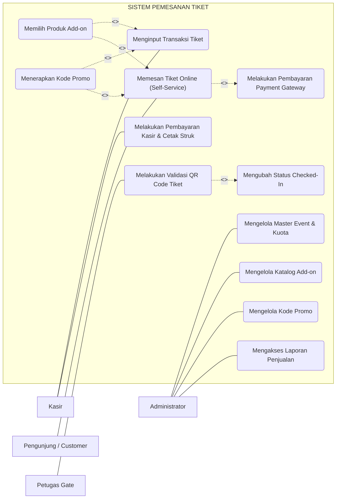
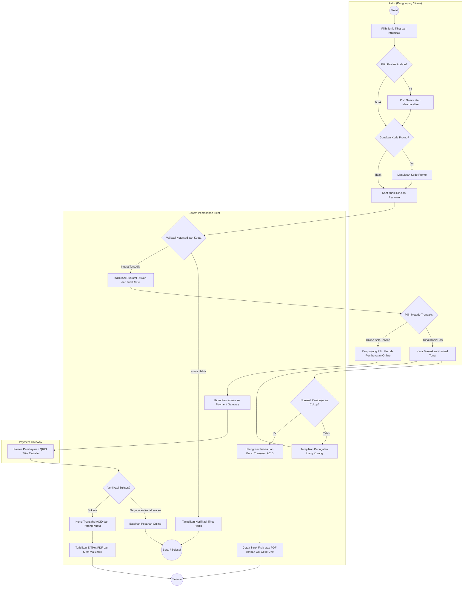
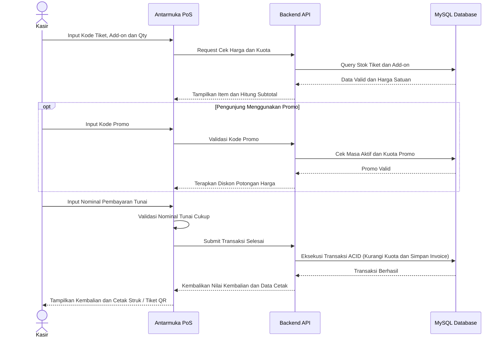
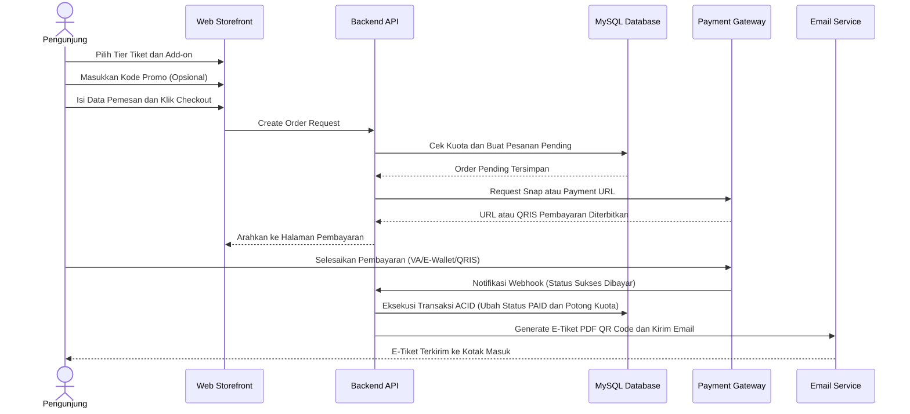
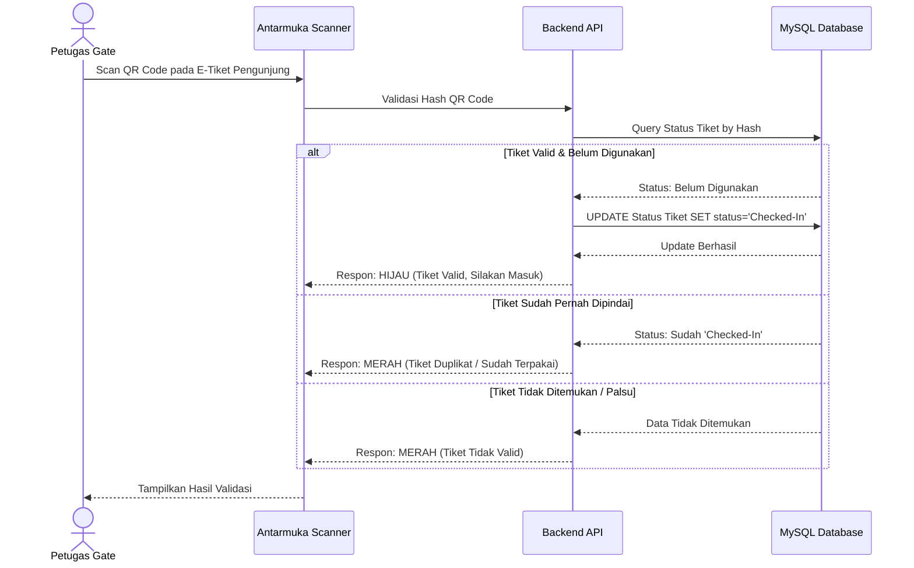
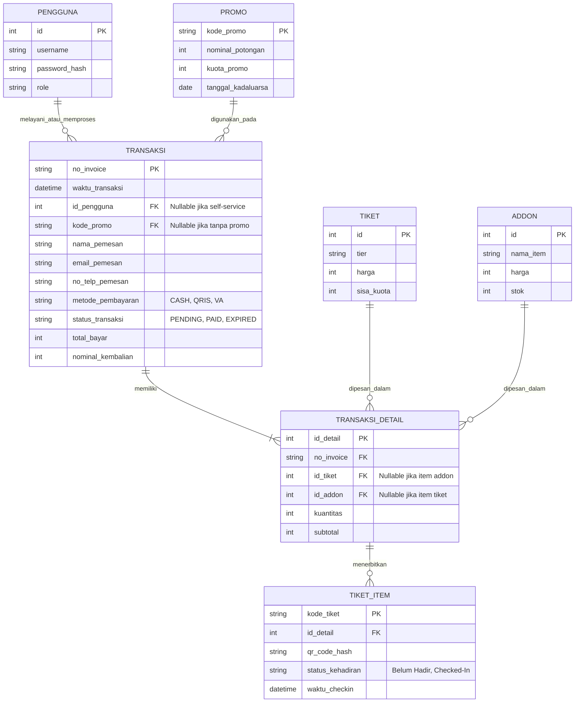

# SPESIFIKASI KEBUTUHAN PERANGKAT LUNAK (SKPL)
## SISTEM PEMESANAN TIKET

**Disusun Oleh/Kelompok 4:**
1. Dimas Ramadhani (103112400065)
2. Ryan Akeyla Novianto Widodo (103112400081)
3. Keishin Naufa Alfaridzhi (103112400061)
4. Ariel Ahnaf Kusuma (103112400050)
5. Abisar Fathir (103112400068)

**PROGRAM STUDI TEKNIK INFORMATIKA**
**FAKULTAS INFORMATIKA**
**UNIVERSITAS TELKOM PURWOKERTO**
**2026**

---

## BAB I PENDAHULUAN

### 1.1 Tujuan
Dokumen Spesifikasi Kebutuhan Perangkat Lunak (SKPL) ini bertujuan untuk mendefinisikan seluruh kebutuhan fungsional dan nonfungsional dari Sistem Pemesanan Tiket. Dokumen ini digunakan sebagai acuan teknis bagi tim pengembang (developer), penguji (Quality Assurance), dan pemangku kepentingan dalam proses konstruksi perangkat lunak.

### 1.2 Ruang Lingkup
Sistem Pemesanan Tiket ini merupakan aplikasi berbasis web yang berfungsi sebagai terminal kasir (Point of Sales) sekaligus sistem ticketing. Ruang lingkup sistem meliputi:
* Pengelolaan master data acara, tier tiket (Batch 1, Batch 2, VIP), dan katalog add-on (snack/merchandise) oleh Administrator.
* Modul transaksi kasir untuk kalkulasi harga pesanan, penerapan diskon kode promo, dan pembayaran (tunai dan non-tunai/QRIS).
* Modul pencetakan struk fisik termal dan penerbitan e-tiket format PDF yang dilengkapi QR Code unik.
* Modul validasi (gate check-in) untuk pemindaian QR Code tiket pada saat acara berlangsung.
* Portal Web Customer (Web Storefront) yang memungkinkan pengunjung untuk mendaftar akun, memilih tiket/add-on, dan melakukan pembayaran secara mandiri secara online (self-service).

### 1.3 Definisi, Akronim, dan Singkatan
* **SKPL**: Spesifikasi Kebutuhan Perangkat Lunak.
* **PoS**: Point of Sales (Sistem Kasir).
* **Tier**: Tingkatan atau kategori tiket yang memiliki harga dan kuota tersendiri.
* **Add-on**: Produk tambahan selain tiket utama, seperti makanan, minuman, atau merchandise.
* **QRIS**: Quick Response Code Indonesian Standard.
* **ERD**: Entity Relationship Diagram.
* **ACID**: Atomicity, Consistency, Isolation, Durability (Prinsip transaksi basis data).

### 1.4 Referensi
* TUGAS #1 - MEMBUAT PERENCANAAN KONSTRUKSI PL.pdf.

---

## BAB II DESKRIPSI UMUM PERANGKAT LUNAK

### 2.1 Perspektif Produk
Sistem Pemesanan Tiket adalah sistem perangkat lunak mandiri berbasis web yang mengintegrasikan layanan front-end (antarmuka kasir dan dasbor admin) dengan backend serverless dan basis data relasional (MySQL) untuk pengelolaan transaksi secara waktu nyata (real-time).

### 2.2 Fungsi Produk
* Manajemen keranjang belanja tiket dan produk add-on.
* Kalkulasi otomatis subtotal, potongan harga (promo), dan kembalian.
* Penerbitan struk transaksi fisik dan digital (e-tiket ber-QR Code).
* Manajemen data master (pengguna, tiket, kuota, promo, laporan) oleh admin.
* Pemindaian (scanning) QR code e-tiket untuk validasi kehadiran.
* Pemesanan tiket dan add-on secara mandiri via portal online pengunjung.
* Integrasi Payment Gateway untuk pemrosesan pembayaran online.

### 2.3 Karakteristik Pengguna
1. **Kasir (PoS Operator)**: Pengguna dengan kemampuan dasar mengoperasikan komputer, bertugas melayani transaksi langsung secara cepat dengan menggunakan antarmuka sistem kasir.
2. **Administrator**: Pengguna dengan otorisasi manajerial, bertugas mengelola keseluruhan konfigurasi sistem, kuota tiket, dan melihat statistik penjualan.
3. **Pengunjung / Pembeli (Customer)**: Pengguna akhir yang melakukan registrasi, memesan tiket secara mandiri melalui portal online, atau bertransaksi secara on-the-spot via kasir, serta menggunakan tiket ber-QR code untuk akses masuk acara.

### 2.4 Batasan Sistem
* Pembelian maksimal dibatasi hingga 4 tiket per transaksi per jenis tiket.
* Sistem mengunci penjualan tiket secara otomatis apabila kuota tier yang bersangkutan telah habis (sold out).

### 2.5 Asumsi dan Ketergantungan
* Sistem diasumsikan selalu terhubung dengan jaringan internet yang stabil.
* Ketergantungan terhadap layanan third-party gateway untuk pembayaran QRIS.
* Printer yang digunakan oleh kasir mendukung ukuran termal standar (58mm/80mm).

---

## BAB III KEBUTUHAN PERANGKAT LUNAK

### 3.1 Kebutuhan Fungsional
* **KF-01**: Sistem harus memungkinkan kasir untuk memasukkan atau memindai kode barang/tiket dan secara otomatis menampilkan harga satuan.
* **KF-02**: Sistem harus mengkalkulasi subtotal dan total akhir secara real-time saat kuantitas item ditambahkan atau dikurangi.
* **KF-03**: Sistem harus memvalidasi ketersediaan kuota tiket sebelum memproses transaksi.
* **KF-04**: Sistem harus memvalidasi dan memotong harga jika kode promo yang dimasukkan valid (sesuai tanggal, minimum transaksi, dan kuota promo).
* **KF-05**: Sistem harus memvalidasi nominal uang tunai yang dimasukkan dan menampilkan informasi uang kembalian.
* **KF-06**: Sistem harus dapat mencetak struk belanja (kertas termal atau PDF) yang memuat QR Code unik untuk validasi masuk.
* **KF-07**: Sistem harus memungkinkan administrator menambah, mengubah, dan menghapus master data tiket, add-on, dan promo.
* **KF-08**: Sistem harus memungkinkan sistem gate check-in untuk memindai QR Code dan menandai status tiket menjadi 'Checked-In'.
* **KF-09**: Sistem harus memiliki portal publik yang memungkinkan pengunjung melakukan registrasi dan login akun secara mandiri.
* **KF-10**: Sistem harus memungkinkan pengunjung untuk memasukkan tiket dan add-on ke keranjang belanja (cart) dan melakukan checkout mandiri secara online.
* **KF-11**: Sistem harus terintegrasi dengan Payment Gateway pihak ketiga untuk memproses pembayaran pengunjung secara online (Virtual Account, E-Wallet, dll).
* **KF-12**: Sistem harus secara otomatis mengirimkan e-tiket ber-QR code ke email pengunjung setelah pembayaran online divalidasi berhasil.

### 3.2 Kebutuhan Nonfungsional
* **KNF-01 (Keamanan)**: Sistem harus mengenkripsi kata sandi menggunakan bcrypt (salt factor >= 10) dan menggunakan Session Token Authentication.
* **KNF-02 (Integritas Data)**: Sistem wajib mengimplementasikan transaksi ACID dan penguncian (locking) pada koneksi MySQL untuk mencegah overselling.
* **KNF-03 (Kinerja)**: Waktu respons API backend maksimal 1000 milidetik (1 detik).
* **KNF-04 (Usability)**: Antarmuka kasir harus mendukung pintasan (shortcut) keyboard-first untuk kecepatan pelayanan transaksi.

### 3.3 Kebutuhan Antarmuka
* **Antarmuka Pengguna**: Dibangun menggunakan Next.js dan Tailwind CSS berbasis web browser.
* **Antarmuka Perangkat Keras**: Terintegrasi dengan alat pemindai barcode (scanner), masukan keyboard dan pencetak struk kasir termal.

---

## BAB IV SPESIFIKASI KEBUTUHAN

### 4.1 Identifikasi Aktor
* **Administrator**: Mengelola operasional sistem di sisi manajerial, master data tiket, kuota, promo, dan laporan keuangan.
* **Kasir**: Melayani transaksi pembelian tiket dan add-on secara langsung di lokasi (on-the-spot) serta mencetak struk belanja.
* **Pengunjung / Pembeli**: Subjek utama yang membeli tiket secara online atau on-the-spot, memanfaatkan promo, dan menghadiri acara.
* **Petugas Gate (Gate Staff)**: Melakukan pemindaian dan verifikasi QR Code e-tiket pengunjung di pintu gerbang acara.

### 4.2 Use Case Diagram

<!-- SILAKAN ISI KODE MERMAID UNTUK USE CASE DIAGRAM PADA BLOK DI BAWAH INI -->

### 4.3 Deskripsi Use Case
* **Mengelola Master Event & Kuota**: Admin mengatur jadwal acara, kategori tier tiket (Batch 1, Batch 2, VIP), harga, dan batas kuota.
* **Mengelola Katalog Add-on**: Admin mengelola katalog produk pelengkap (snack/merchandise), harga satuan, dan ketersediaan stok.
* **Mengelola Kode Promo**: Admin membuat voucher diskon, mengatur batas masa aktif, ketentuan minimal transaksi, dan kuota pemakaian.
* **Mengakses Laporan Penjualan**: Admin memantau rekapitulasi data penjualan harian, statistik per tier, dan ekspor laporan transaksi.
* **Menginput Transaksi Tiket**: Kasir memasukkan pesanan tiket pengunjung langsung di lokasi ke keranjang belanja PoS.
* **Memesan Tiket Online (Self-Service)**: Pengunjung memilih tiket dan kuantitas tiket secara mandiri via web portal.
* **Memilih Produk Add-on (Extend)**: Opsi tambahan bagi pembeli tiket untuk menambahkan snack/merchandise ke dalam keranjang transaksi.
* **Menerapkan Kode Promo (Extend)**: Opsi bagi pembeli untuk mengklaim kode kupon diskon guna memotong total tagihan jika syarat terpenuhi.
* **Melakukan Pembayaran Kasir & Cetak Struk**: Kasir menginput nominal pembayaran tunai/non-tunai dan mencetak struk fisik atau PDF ber-QR Code.
* **Melakukan Pembayaran Payment Gateway (Include)**: Pengunjung menyelesaikan transaksi online secara otomatis melalui gateway pembayaran (VA, QRIS, e-wallet).
* **Melakukan Validasi QR Code Tiket**: Petugas gate memindai QR Code pada struk/e-tiket pengunjung saat memasuki arena acara.
* **Mengubah Status Checked-In (Include)**: Sistem memvalidasi keaslian tiket dan memperbarui statusnya menjadi 'Checked-In' secara otomatis untuk mencegah pemakaian ulang.

### 4.4 Activity Diagram

<!-- SILAKAN ISI KODE MERMAID UNTUK ACTIVITY DIAGRAM PADA BLOK DI BAWAH INI -->

### 4.5 Sequence Diagram

#### 4.5.1 Sequence Diagram Transaksi Kasir (PoS)
<!-- SILAKAN ISI KODE MERMAID UNTUK SEQUENCE DIAGRAM KASIR PADA BLOK DI BAWAH INI -->

#### 4.5.2 Sequence Diagram Pemesanan Tiket Online (Customer)
<!-- SILAKAN ISI KODE MERMAID UNTUK SEQUENCE DIAGRAM PEMBELI ONLINE PADA BLOK DI BAWAH INI -->

#### 4.5.3 Sequence Diagram Validasi Gate Check-in
<!-- SILAKAN ISI KODE MERMAID UNTUK SEQUENCE DIAGRAM VALIDASI GATE PADA BLOK DI BAWAH INI -->

### 4.6 Kebutuhan Data
* **Data Pengguna**: Menyimpan kredensial admin dan kasir.
* **Data Event & Tiket**: Menyimpan nama event, jenis tier tiket, harga, batas kuota.
* **Data Add-on**: Menyimpan informasi produk tambahan (snack) beserta harga dan stok.
* **Data Promo**: Menyimpan string kode promo, kuota potongan, nilai potongan, status aktif.
* **Data Transaksi**: Menyimpan rekam jejak transaksi historis, waktu, kasir penanggung jawab, serta relasi ke detail pesanan item/tiket.

### 4.7 Entity Relationship Diagram (ERD)
<!-- SILAKAN ISI KODE MERMAID UNTUK ENTITY RELATIONSHIP DIAGRAM (ERD) PADA BLOK DI BAWAH INI -->

---

## BAB V KETENTUAN DAN BATASAN IMPLEMENTASI

### 5.1 Teknologi yang Digunakan
* **Perancangan Antarmuka dan Pengalaman Pengguna**: Figma.
* **Frontend**: Next.js (React), JavaScript, dan Tailwind CSS untuk antarmuka terminal kasir, dasbor administrator, portal mandiri pengunjung, serta antarmuka pemindai gerbang masuk.
* **Backend**: Node.js (Next.js API Routes).
* **Layanan dan Pustaka Pihak Ketiga**:
  * Antarmuka Pemrograman Aplikasi Payment Gateway untuk pemrosesan transaksi daring dan non-tunai.
  * Layanan Simple Mail Transfer Protocol untuk pengiriman e-tiket ke surat elektronik pembeli.
* **Pustaka pembuat QR Code dan berkas Portable Document Format**.

### 5.2 Platform Sistem
* Sistem dibangun berbasis web yang dapat diakses melalui peramban modern, serta dirancang responsif agar beroperasi optimal pada perangkat komputer meja maupun telepon pintar.

### 5.3 Database
* Sistem menggunakan MySQL sebagai Sistem Manajemen Basis Data Relasional untuk menjamin integritas data transaksi dan kuota tiket.

### 5.4 Batasan Implementasi
* Pembelian tiket dibatasi maksimal 4 tiket per transaksi untuk setiap kategori tiket guna mencegah penimbunan.
* Transaksi basis data berprinsip ACID wajib diterapkan pada lapisan backend guna mencegah kondisi perebutan kuota tiket saat transaksi berlangsung serentak.
* Batas waktu penyelesaian pembayaran daring ditetapkan maksimal 15 menit sebelum pesanan otomatis kedaluwarsa.
* Setiap kode QR tiket individual hanya memiliki otorisasi satu kali masuk pada gerbang acara.

---

## BAB VI KRITERIA PENERIMAAN

### 6.1 Acceptance Criteria
* Struk transaksi kasir berhasil dicetak secara jelas melalui pencetak termal ukuran 58 milimeter atau 80 milimeter, atau diunduh dalam format berkas PDF.
* Kuota tiket berkurang secara tepat sesuai jumlah item yang dibeli saat transaksi tunai selesai atau saat notifikasi pembayaran daring terverifikasi.
* Transaksi kasir otomatis ditolak jika nominal uang tunai yang dimasukkan kurang dari total tagihan.
* Sistem menerbitkan e-tiket dengan kode QR unik dan mengirimkannya ke alamat surat elektronik pembeli paling lambat 60 detik setelah pembayaran daring terkonfirmasi.
* Sistem pemindai gerbang berhasil memvalidasi keabsahan kode QR tiket dan langsung memperbarui status kehadiran menjadi terpakai sehingga tiket tidak dapat digunakan berulang kali.

### 6.2 Skenario Pengujian Kebutuhan
* Pengujian Kotak Hitam pada modul keranjang belanja kasir dan portal pemesanan daring pengunjung.
* Pengujian Penerimaan Pengguna untuk memverifikasi kemudahan navigasi keyboard kasir dan alur pemesanan mandiri pembeli.
* Pengujian Konkurensi untuk menguji ketahanan basis data terhadap transaksi simultan agar tidak terjadi penjualan tiket melebihi sisa kuota.
* Pengujian Integrasi Jalur Pembayaran untuk memvalidasi alur notifikasi status pembayaran berhasil, gagal, dan kedaluwarsa.
* Pengujian Validasi Gerbang Masuk terhadap skenario tiket sah, tiket duplikat yang sudah pernah dipindai, dan tiket yang tidak terdaftar di sistem.

---

## LAMPIRAN

### A. Dokumen Pendukung
* Lembar kerja pelacakan proyek (Controlling Works.xlsx).
